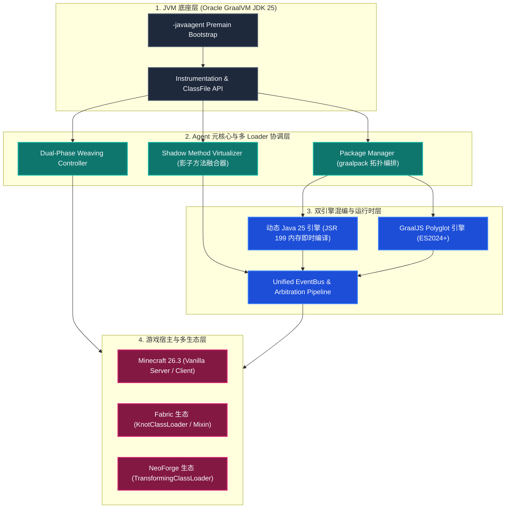

# 系统全景架构 (System Architecture)

`graal-agent` 是面向 Minecraft 现代与未来版本（26.3 Mojang 映射）的 **Universal Meta-Loader（全能元加载器）与双引擎运行时底座**。它打破了传统 ModLoader（Fabric / NeoForge）相互排斥、笨重且无法热重载的壁垒，建立了一套在 JVM 顶层协调多方生态的高性能统一架构。

---

## 1. 层次化架构模型 (Layered Architecture)

整个系统自底向上划分为四个核心层级：



---

## 2. 核心组件交互机制

### 2.1 启动与引导编排 (Bootstrap Lifecycle)
1. **JVM 前置接管：** 启动参数挂载 `-javaagent:graal-agent.jar`，在系统类加载器中激活 `premain`。
2. **多 Loader 环境探测：** 自动探测当前运行目录是否存在 Fabric、NeoForge 依赖库或纯原版服务端/客户端。
3. **微包依赖解析：** 扫描 `packages/` 目录，读取各包的 `graalpack.json`，构建 [[Terminology#Dependency DAG (依赖有向无环图)|依赖拓扑图]]，按优先级排序。
4. **双阶段字节码注入：**
   - **Pre-Mixin 阶段：** 拦截第三方 Loader 的类加载器入口，注入跨环境通用垫片。
   - **Post-Mixin 阶段：** 在类写入 JVM `defineClass` 前，执行 [[Shadow-Method-Virtualization|影子方法虚拟化]] 注入。

### 2.2 类加载器拓扑关系 (ClassLoader Topology)

为了确保动态 Java 能够随时卸载热更，同时避免与游戏对象产生类型转换异常，类加载器遵循以下层级模型：

```
                    BootstrapClassLoader (JVM 原生类)
                               ▲
                               │
                    AppClassLoader (graal-agent.jar, GraalJS, JDK 编译器)
                               ▲
                               │
            ┌──────────────────┴──────────────────┐
            │                                     │
   KnotClassLoader (Fabric)             TransformingClassLoader (NeoForge)
            ▲                                     ▲
            │                                     │
    Fabric Mods (JAR)                    NeoForge Mods (JAR)
            │                                     │
            └──────────────────┬──────────────────┘
                               ▲
                               │ (通过 Agent 主总线交互)
             ┌─────────────────┴─────────────────┐
             │                                   │
   PackageClassLoader-A                PackageClassLoader-B
   (graalpack: magic-combat)              (graalpack: tech-machinery)
   [动态编译生成的 Java 类]             [动态编译生成的 Java 类]
```

> [!tip] 内存安全保证
> 游戏世界实体（如 `Player`、`Level`）均由上层公共加载器唯一定义，所有子加载器均可安全引用，杜绝 `ClassCastException`。

---

## 3. 核心设计原则

1. **堆内存唯一，代码多视点：** 坚决维护一份共享游戏状态，通过 [[Shadow-Method-Virtualization|影子方法]] 实现多 Loader 逻辑隔离共存。
2. **零重启热重载体验：** 无论是 JS 还是 Java 源码，修改保存后秒级生效（Java 内存编译耗时 < 100ms）。
3. **弹性容灾降级：** 遇到未仲裁的逻辑冲突时，[[Terminology#Non-Fatal Collision Arbitration (非崩溃式冲突仲裁)|记录告警并安全降级]]，绝不崩溃游戏。
4. **轻量原子包管理：** 使用 [[Package-System|graalpack 格式]] 组织一切模组、脚本与数据包，彻底终结混乱的手工放置。

---

## 关联导航
- 核心术语体系：[[Terminology|核心术语与概念体系]]
- 字节码融合规范：[[Shadow-Method-Virtualization|影子方法虚拟化与融合规范]]
- 模块化微包规范：[[Package-System|graalpack 模块化微包规范]]
- 双引擎运行时规范：[[Dual-Engine-Runtime|双引擎运行时与动态编译]]
- 多 Loader 协调：[[Multi-Loader-Compatibility|多 ModLoader 兼容与字节码协调]]
- 研发实施路线图：[[Roadmap-and-Tracks|实施路线图与 Track 拆解]]
