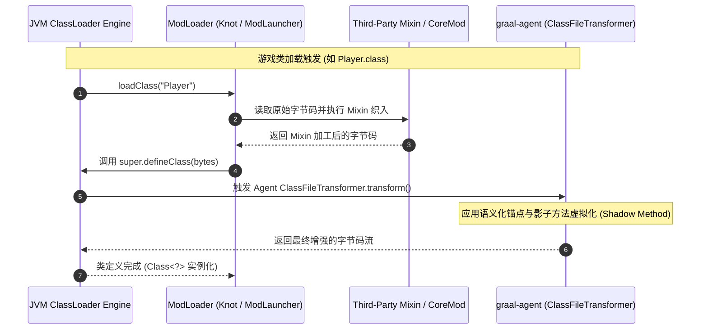

# 多 ModLoader 兼容与字节码协调 (Multi-Loader Compatibility & Weaving)

## 1. 现实生态挑战

Minecraft 模组生态长期处于割裂状态：
- **Fabric 生态：** 基于 `net.fabricmc.loader.impl.launch.knot.KnotClassLoader`，核心以 SpongePowered Mixin 作为唯一的字节码操作手段，推崇轻量与快速更新。
- **NeoForge / Forge 生态：** 基于 `cpw.mods.modlauncher.TransformingClassLoader`，拥有庞大的事件总线（EventBus）、Capability/Attachment 系统以及复杂的 CoreMod / AccessTransformer 机制。

传统的模组只能在其中选择一个阵营。而 `graal-agent` 作为运行在 JVM `-javaagent` 顶层的元加载器，目标是**提供跨 Loader 的和平共存与协同调度能力**。

---

## 2. 字节码执行管道与时序编排



### 关键时序优势：
- 我们的 Agent 是类定义（`defineClass`）前的**最后一道绝对防线**。
- 这意味着，无论第三方模组的 Mixin 对类做了多么激进的注入，我们都能拿到其最终产物，并用 [[Shadow-Method-Virtualization|影子方法]] 将其妥善收纳和受控分流，绝不会被第三方模组覆盖。

---

## 3. 语义化锚点 (Semantic Anchoring) 防御机制

当多个模组同时使用 Mixin 修改同一个方法时，传统的行号或字节偏移量注入必然失效。Agent 使用 Java 25 `java.lang.classfile` 实施**语义化模式匹配**：

```java
// 语义化锚点匹配示例：精确在所有返回指令前植入后置监听
builder.transformMethod(methodModel, MethodTransform.transformingCode((codeBuilder, codeElement) -> {
    if (codeElement instanceof ReturnInstruction returnInst) {
        // 匹配到真实的语义返回点（无论前面被 Mixin 插入了多少指令）
        codeBuilder.invokestatic(
            ClassDesc.of("com.graalagent.bridge.AgentBridge"),
            "onMethodExitHook",
            MethodTypeDesc.ofDescriptor("()V")
        );
    }
    codeBuilder.with(codeElement);
}));
```

### 语义化匹配原则：
1. **结构优于位置：** 永远匹配控制流结构（`ReturnInstruction`、`ThrowInstruction`、特定方法的 `InvokeInstruction`），杜绝绝对指令计数。
2. **栈图自动维护：** 借助 Java 25 Class-File API 的自动 StackMap 重新生成，确保在现代 JVM 严苛的验证器下不报 `VerifyError`。

---

## 4. 跨 Loader 运行时状态检测与事件桥接

Agent 自动探测宿主环境并挂载适配桥梁：

```java
public class EnvironmentDetector {
    public static boolean hasFabric() {
        try {
            Class.forName("net.fabricmc.loader.api.FabricLoader");
            return true;
        } catch (ClassNotFoundException e) {
            return false;
        }
    }

    public static boolean hasNeoForge() {
        try {
            Class.forName("net.neoforged.fml.ModList");
            return true;
        } catch (ClassNotFoundException e) {
            return false;
        }
    }
}
```

- **无 Loader 环境 (纯原版 Server/Client)：** Agent 充当完整的轻量模组底座，自建事件总线并接管原版生命周期。
- **有 Loader 环境 (Fabric / NeoForge)：** Agent 自动接入其生命周期事件（如 Fabric `ServerLifecycleEvents` 或 NeoForge `ServerStartingEvent`），将外部模组事件双向转推给微包中的 Java 与 JS 脚本。

---

## 关联导航
- 核心术语体系：[[Terminology|核心术语与概念体系]]
- 系统全景架构：[[Architecture|系统全景架构]]
- 影子方法融合：[[Shadow-Method-Virtualization|影子方法虚拟化与融合规范]]
- 模块化微包规范：[[Package-System|graalpack 模块化微包规范]]
- 实施路线与规划：[[Roadmap-and-Tracks|实施路线图与 Track 拆解]]
