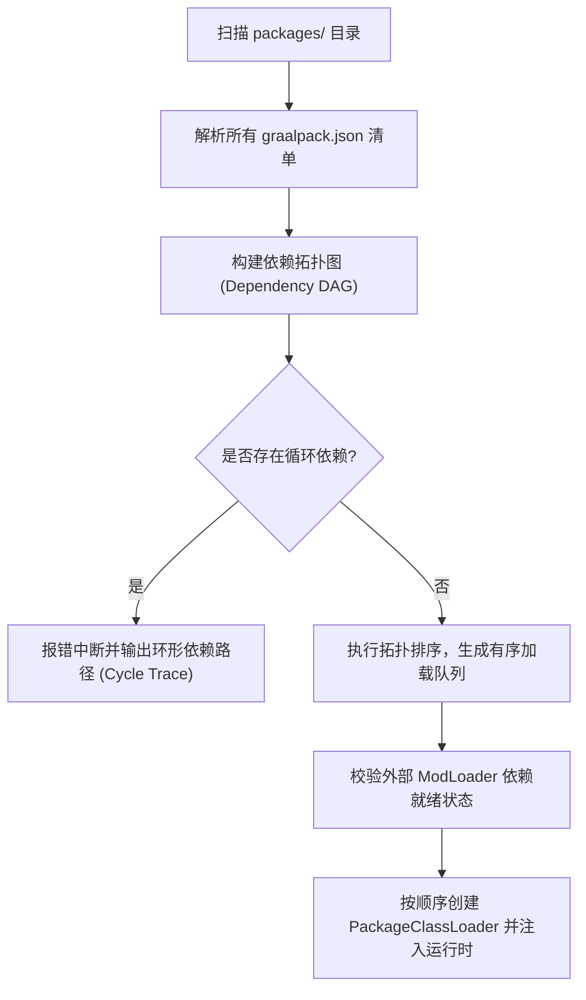

# graalpack 模块化微包规范与包管理器 (Package System Specification)

## 1. 概述与设计理念

`graalpack` 是 `graal-agent` 生态中的**原子级自包含扩展模块**。它借鉴了现代前端（npm）与高级包管理器的设计哲学，彻底改变了传统 Minecraft 模组散乱放置在 `mods/` 目录且无法声明统一依赖的混乱现状。

每个 `graalpack` 都是一个高度内聚的目录（或 `.graalpack` 压缩归档），能够把 **高性能动态 Java 源码、敏捷 JS 脚本、原版数据包、资源包以及依赖清单** 捆绑在一起。

---

## 2. 微包标准目录结构

位于根目录 `packages/<package-id>/` 下：

```
packages/
└── magic-combat/
    ├── graalpack.json               # [必须] 微包核心清单描述文件
    ├── README.md                 # [可选] 说明文档
    ├── src/                      # [可选] 动态 Java 25 源码 (内存编译)
    │   ├── CombatArbitrator.java # 冲突仲裁与高性能 Hook
    │   └── SpellMath.java        # 高性能数学与法术逻辑
    ├── scripts/                  # [可选] GraalJS 脚本 (动态求值)
    │   ├── index.js              # 玩法入口
    │   └── spells/
    │       └── fireball.js       # 火球术事件与指令
    ├── datapacks/                # [可选] 随包自动挂载的原版数据包
    │   └── data/magic/recipes/...
    ├── assets/                   # [可选] 随包生成的资源包 (纹理、模型)
    │   └── assets/magic/textures/...
    └── lib/                      # [可选] 本微包私有引用的预编译 jar 库
        └── fastutil-mini.jar
```

---

## 3. 清单规范 (`graalpack.json` Schema)

`graalpack.json` 采用严格的 UTF-8 编码 JSON 格式。示例如下：

```json
{
  "$schema": "https://graal-agent.com/schemas/graalpack-v1.json",
  "id": "magic-combat",
  "name": "Magic & Combat Overhaul",
  "version": "1.2.0",
  "description": "基于双引擎混编的高性能法术战斗扩展微包",
  "authors": ["Kero", "AgentTeam"],
  "license": "MIT",
  "environment": "dual",

  "entrypoints": {
    "java": [
      "src/CombatArbitrator.java"
    ],
    "js": [
      "scripts/index.js"
    ]
  },

  "dependencies": {
    "packages": {
      "core-library": "^2.0.0"
    },
    "fabric": {
      "fabric-api": ">=0.92.0"
    },
    "neoforge": {
      "curios": ">=5.9.0"
    }
  },

  "arbitration": {
    "rules": {
      "Player.hurt": "prefer-higher-damage",
      "Item.use": "pipeline"
    },
    "defaultFallback": "last-arrived"
  }
}
```

### 字段说明表：
- `id`: 全局唯一标识符，仅限小写字母、数字、短横线 `-` 和下划线 `_`。
- `environment`: 运行环境支持：`client`（仅客户端）、`server`（仅专用服务端）、`dual`（双端无缝支持）。
- `entrypoints.java`: 动态 Java 主入口类路径（由 [[Dual-Engine-Runtime|JSR 199 内存编译器]] 优先编译载入）。
- `entrypoints.js`: GraalJS 主入口脚本。
- `dependencies`: 声明其对其他微包，以及对外部 Fabric / NeoForge 模组的版本约束。
- `arbitration`: 该微包声明的针对特定原版方法的 [[Shadow-Method-Virtualization#3-主流水线调度器代码范式-master-pipeline-router|影子方法仲裁策略]]。

---

## 4. 依赖解析与拓扑加载流程 (Dependency DAG)

在游戏启动前，包管理器通过以下算法完成微包的发现与排序：



> [!important] 外部依赖就绪检查 (Readiness Check)
> 若微包声明了 `"fabric": { "fabric-api": ">=0.92.0" }`，但当前未安装 FabricLoader 或缺失 Fabric-API，包管理器会在控制台输出明确的高亮前置警告，并根据包配置决定是否安全停用该包（不使整个游戏闪退）。

---

## 5. 两阶段演进路线

1. **第一阶段：本地拓扑编排与自治管理（当前核心任务）**
   - 实现本地 `packages/` 目录的扫描与元数据校验。
   - 实现 DAG 依赖拓扑排序与版本语义检查（SemVer）。
   - 实现微包独立的 [[Dual-Engine-Runtime#2-微包独立类加载器-packageclassloader|PackageClassLoader]] 隔离加载。
   - 联动 `WatchService` 实现单个微包的独立热重载。
2. **第二阶段：远程仓库与在线依赖安装**
   - 接入 Modrinth API、CurseForge API 与官方微包 Hub。
   - 提供游戏内与控制台指令：`/graalpack install <package-id>`。
   - 自动解析远程依赖树，补全缺失的第三方 ModLoader jar 与依赖微包。

---

## 关联导航
- 核心术语体系：[[Terminology|核心术语与概念体系]]
- 系统全景架构：[[Architecture|系统全景架构]]
- 双引擎运行时规范：[[Dual-Engine-Runtime|双引擎运行时与动态编译]]
- 影子方法融合：[[Shadow-Method-Virtualization|影子方法虚拟化与融合规范]]
- 实施路线与规划：[[Roadmap-and-Tracks|实施路线图与 Track 拆解]]
