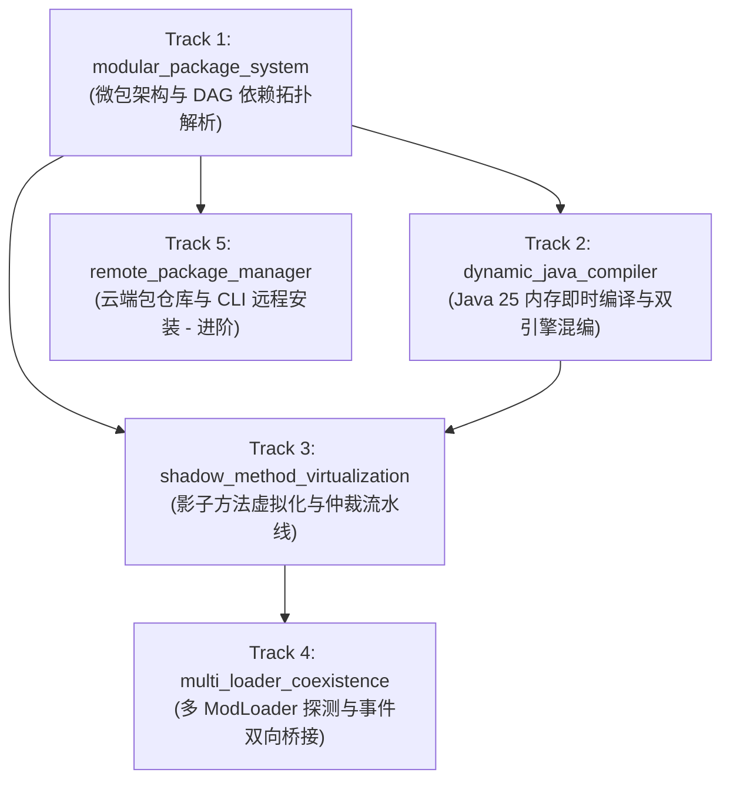

# 实施路线图与 Track 拆解建议 (Roadmap & Track Breakdown)

## 1. 拆解战略原则

正如我们讨论所指出的：**“计划宏大，必须拆分为若干个小粒度、高内聚、高可验证的 Track”**。

每个 Track 均遵循 Conductor 的严格规范：
- 具备独立的 `spec.md` 和 `plan.md`。
- 遵循测试驱动开发（TDD：Red -> Green -> Refactor）。
- 单个 Java 源码文件严格控制在 600 行以内。
- 100% 自动化单元测试覆盖。

---

## 2. 推荐拆解的工程 Tracks 规划

### 🔹 Track 1: `modular_package_system` (微包基础架构与 DAG 拓扑解析)
- **目标：** 建立微包目录标准与包管理器内核。
- **核心任务：**
  1. 制定并实现 `mcpack.json` 解析器与 JSON Schema 校验。
  2. 实现 `packages/` 目录扫描与本地微包元数据索引。
  3. 实现基于 Kahn 算法的 DAG 依赖拓扑排序，能够检测环形依赖并报错。
  4. 实现基础生命周期接口（`load`, `enable`, `disable`）。
- **交付验收：** 针对各种依赖图结构（线性、菱形、循环依赖、前置缺失）的 100% 单元测试。
- **关联规范：** [[Package-System|mcpack 模块化微包规范]]

---

### 🔹 Track 2: `dynamic_java_compiler` (Java 25 内存编译与双引擎混编)
- **目标：** 让开发者能在微包中编写 `.java` 源码，保存即在内存中完成编译并生效。
- **核心任务：**
  1. 基于 JDK 25 `javax.tools.JavaCompiler` 实现内存编译管道（`In-Memory JavaFileManager`）。
  2. 实现可动态卸载与垃圾回收的 `PackageClassLoader`。
  3. 建立动态 Java 类与 GraalJS 的双向反射调用通道（`Java.type` 与 `EventBus` 互通）。
  4. 接入 `WatchService`，实现 `.java` 文件变动时的无重启秒级热重载。
- **交付验收：** 编写测试用例验证动态加载 Java 类、计算耗时（<100ms）以及热重载后旧类元空间正常解绑。
- **关联规范：** [[Dual-Engine-Runtime|双引擎运行时与动态编译规范]]

---

### 🔹 Track 3: `shadow_method_virtualization` (影子方法虚拟化与仲裁流水线)
- **目标：** 实现单堆内存对象上多实现分流的“影子方法”与防闪退仲裁器。
- **核心任务：**
  1. 使用 Java 25 `java.lang.classfile` 编写通用切片变形器（将目标方法克隆为 `method$vanilla` 等影子）。
  2. 动态生成 `Master Pipeline Router` 主调度方法体，注入前置与后置切片。
  3. 实现冲突仲裁管线（支持脚本规则、数值流水线传递、非崩溃式安全降级）。
  4. 建立断路器（Circuit Breaker），捕获异常影子方法并打告警日志。
- **交付验收：** 针对多方修改冲突的模拟测试，验证游戏不闪退、数据正确传递、原版兜底生效。
- **关联规范：** [[Shadow-Method-Virtualization|影子方法虚拟化与融合规范]]

---

### 🔹 Track 4: `multi_loader_coexistence` (多 ModLoader 探测与事件双向桥接)
- **目标：** 解决与真实 Fabric / NeoForge 运行时的类加载器交互与事件流打通。
- **核心任务：**
  1. 实现 `EnvironmentDetector`，精准识别 Fabric、NeoForge 及其版本。
  2. 拦截 `KnotClassLoader` 与 `TransformingClassLoader` 的核心阶段。
  3. 建立通用事件适配层，将 Fabric / NeoForge 的生命周期与玩家事件无缝推入微包事件总线。
- **交付验收：** 在模拟的多 Loader 类加载环境中验证 Agent 正确接入并无缝响应事件。
- **关联规范：** [[Multi-Loader-Compatibility|多 ModLoader 兼容与字节码协调]]

---

### 🔹 Track 5: `remote_package_manager` (云端包仓库与 CLI 自动安装 - 进阶)
- **目标：** 打造如同 `npm` 一般丝滑的 Minecraft 包管理体验。
- **核心任务：**
  1. 实现基于 HTTP/JSON 的 Modrinth / CurseForge / GitHub Releases 远程解析器。
  2. 提供控制台与游戏内指令：`/mcpack install <id>`、`/mcpack update`、`/mcpack remove`。
  3. 实现哈希校验（SHA-256）与自动化依赖包解压归档。
- **交付验收：** 模拟网络请求测试包下载、依赖递归安装与热挂载。

---

## 关联导航
- 回到首页：[[Index|文档首页]]
- 核心术语体系：[[Terminology|核心术语与概念体系]]
- 系统全景架构：[[Architecture|系统全景架构]]
- 模块化微包规范：[[Package-System|mcpack 模块化微包规范]]
- 双引擎运行时规范：[[Dual-Engine-Runtime|双引擎运行时与动态编译]]
- 影子方法融合：[[Shadow-Method-Virtualization|影子方法虚拟化与融合规范]]
- 多 Loader 协调：[[Multi-Loader-Compatibility|多 ModLoader 兼容与字节码协调]]
