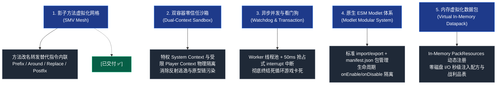

# 新一代架构技术蓝图索引 (New Base Architecture Index)

欢迎查阅 **Graal-Agent 新一代架构技术蓝图与工程实现知识库 (New Base Architecture Specification & Implementations)**。

本技术体系是基于对前代原型系统的代码审查与痛点反思，在“思维实验”与渐进式重构中达致最佳工程状态的全套全新设计规范与交付落地代码库。本体系确立了针对现代 Minecraft（26+ 无符号混淆版本）的零加载器侵入、企业级高可用、安全零信任的 JavaScript/Polyglot 脚本运行环境标准。

---

## 🏛️ 核心设计支柱 (Architectural Pillars)

---

## 🚦 工程阶段交付状态矩阵 (Delivery Matrix)

| 工程阶段 | 核心模块与实现 | 交付成果与源码资产 | 验证与测试套件 | 状态 |
| :--- | :--- | :--- | :--- | :---: |
| **第一阶段：基础设施重构** `phase1_foundation_infra` | 反射句柄高速缓存池、统一指令网关、异步遥测中心、强类型配置与依赖注入 | [`MethodHandleCache.java`](../../src/com/graalagent/bridge/MethodHandleCache.java) [`BrigadierAdapter.java`](../../src/com/graalagent/bridge/brigadier/BrigadierAdapter.java) [`DiagnosticsHub.java`](../../src/com/graalagent/diagnostics/DiagnosticsHub.java) [`AgentConfig.java`](../../src/com/graalagent/bootstrap/AgentConfig.java) [`LibraryInjector.java`](../../src/com/graalagent/bootstrap/LibraryInjector.java) | 4 套单元测试类 (100% 通过) [`07_bench_and_diagnostics.js`](../../scripts/07_bench_and_diagnostics.js) (提速 **91.3%**) | ✅ 已交付 (Delivered) |
| **第二阶段：SMV 字节码网格** `phase2_smv_bytecode_mesh` | 核心虚拟化器、网格调度器、客户端/服务端 8 大微插件、启动器解耦脱壳 | [`MethodVirtualizer.java`](../../src/com/graalagent/transformer/smv/MethodVirtualizer.java) [`SMVOrchestrator.java`](../../src/com/graalagent/transformer/SMVOrchestrator.java) [`ClassTransformPlugin.java`](../../src/com/graalagent/transformer/ClassTransformPlugin.java) 8 大微插件实现类 彻底移除旧版 402 行巨石单体类 | 4 套微插件单元测试类 4 个 JS 实机验证脚本 一键验证总线 [`verify-smv.ps1`](../../verify-smv.ps1) | ✅ 已交付 (Delivered) |
| **第三阶段：核心并发与看门狗** `phase3_concurrency_watchdog` | 读写锁解耦、异步 Worker 线程池、50ms 超时看门狗硬中断、MPSC 事务缓冲队列 | 规划设计完毕，待实施 | 计划验收：聊天栏死循环 50ms 内熔断且主线程 TPS 保持 20.0 | ⏳ 待实施 (Planned) |
| **第四阶段：双容器安全隔离** `phase4_dual_context_security` | 双容器物理隔离、零信任 HostAccess、闭包安全令牌、原型链深冻结 | 规划设计完毕，待实施 | 计划验收：异步定时器沙箱逃逸测试必然抛出 SecurityException | ⏳ 待实施 (Planned) |
| **第五阶段：现代模块与虚拟资源** `phase5_esm_modlet_virtual_pack` | 标准 ESM 加载器、Modlet 包规范、DAG 拓扑排序、纯内存虚拟数据包 | 规划设计完毕，待实施 | 计划验收：动态配方/标签秒级加载，零物理磁盘 I/O 写入 | ⏳ 待实施 (Planned) |
| **第六阶段：兼容性垫片与生产交付** `phase6_compatibility_delivery` | 旧版单文件扁平脚本垫片、全系统综合压力测试与 20 TPS 稳定性验收 | 规划设计完毕，待实施 | 计划验收：旧版脚本资产零改动无缝运行 | ⏳ 待实施 (Planned) |

---

## 📚 规范与实现文档导航矩阵

本知识库完全遵循 **Wiki-Markdown** 规范，各文档通过双向链接深入互联：

### 一、顶层设计与术语体系
- [[Terminology-and-Concepts|核心术语与物理概念体系]]：定义全能元加载器、SMV、方法句柄缓存、闭包安全令牌与双引擎混编等物理模型。
- [[Vision-and-Principles|架构愿景与设计哲学]]：新一代系统愿景、反脆弱理念、零加载器纯粹性与目标质量属性 (SLOs)。
- [[System-Architecture|系统分层拓扑与微内核架构]]：系统五层微内核拓扑图、领域服务类图与全流程运行时序。

### 二、底层插桩与类加载解耦 (已交付 ✅)
- [[Module-Bootstrap|引导装载与类加载脱壳规范]]：强类型参数解析、系统类加载器确定性挂载、关键依赖类门禁与 Bundler 启动器脱壳。
- [[Module-SMV-Mesh|影子方法虚拟化网格规范与微插件集]]：JDK 24+ Class-File API 落地、两阶段虚拟化算法、8 大客户端/服务端微插件与巨石单体类的废除。

### 三、跨端通信与可观测性 (已交付 ✅)
- [[Module-Bridge-and-Dispatcher|跨端桥接与统一指令网关]]：`MethodHandleCache` 句柄池（纳秒级预热与调用）、`BrigadierAdapter` 流式 DSL 与全服秒级指令树网络同步。
- [[Module-Diagnostics-and-Logging|结构化遥测与多维日志诊断]]：多级别 ANSI 彩色日志、非阻塞异步队列写盘、动态反射 Log4j 2 探针与故障现场崩溃快照转储。

### 四、执行引擎、并发与安全 (设计规划)
- [[Module-DualContext-Engine|双容器隔离引擎与看门狗抢占机制]]：特权系统容器与零信任沙箱池、50ms 超时看门狗强制抢占中断（`context.interrupt`）防死循环卡死。
- [[Module-Concurrency-and-Events|异步事务缓冲与无锁事件总线]]：读写锁解耦热重载、无锁 `CopyOnWriteArrayList` 事件总线与 MPSC 主线程事务缓冲队列。
- [[Module-Security-Specification|闭包安全令牌与零信任沙箱规范]]：闭包不可变 `SecurityContext` 快照防异步逃逸、零信任 HostAccess 与全局原型链深度冻结。

### 五、模块生态与原生资源 (设计规划)
- [[Module-ESM-Modlet-System|标准 ESM 运行时与 Modlet 模块包体系]]：标准 ECMAScript 模块导入、Modlet 目录与 `manifest.json` 规范、生命周期挂钩与增量热重载。
- [[Module-Virtual-Datapack|虚拟内存数据包与动态资源管线]]：纯堆内存 `PackResources` 实现、声明式配方/标签 DSL 与零磁盘 I/O 动态秒级热注入。

### 六、验证矩阵与演进路线
- [[Verification-and-Testing|验证与基准测试套件体系]]：Java 离线单元测试、GraalJS 实机脚本模拟、双层验证架构与自动化运行指南。
- [[Refactoring-and-Migration-Plan|演进路线与重构落地实施计划]]：六阶段实施路线甘特图、交付里程碑全景与风险应对策略。

---

## ⚡ 与前代原型实现的核心演进对比

| 核心维度 | 前代原型实现 (`src/` 历史债务) | 新一代架构与交付实现 (`docs/new_base/`) |
| :--- | :--- | :--- |
| **字节码插桩** | 402 行巨石单类 `MinecraftTransformer`，硬编码底层字节码指令 | [[Module-SMV-Mesh|SMV 影子网格]]：方法重命名隔离 + 虚拟分发桩，8 大微插件流水线 (已交付 ✅) |
| **指令系统** | 客户端/服务端大面积重复手写 100 余行 Brigadier 动态反射与代理 | [[Module-Bridge-and-Dispatcher|BrigadierAdapter]]：统一 Fluent DSL 门面，全服秒级指令推送 (已交付 ✅) |
| **反射效率** | 高频路径反复 `Class.forName` / `getMethod`，无法 JIT 内联 | [[Module-Bridge-and-Dispatcher|MethodHandleCache]]：方法句柄预热与高速缓存，单次调用提速 91.3% (已交付 ✅) |
| **系统遥测** | 同步写文件阻塞主线程，纯白控制台，故障现场无记录 | [[Module-Diagnostics-and-Logging|DiagnosticsHub]]：异步非阻塞写队列 + ANSI 彩色 + 崩溃现场转储 (已交付 ✅) |
| **脚本容器** | 单一共享 Context，粗粒度 ThreadLocal 沙箱标记 | [[Module-DualContext-Engine|双容器隔离]]：特权系统环境与零信任玩家沙箱物理隔离 |
| **死循环防御** | 死循环瞬间冻结游戏主线程导致游戏无响应或崩溃 | [[Module-DualContext-Engine|异步 Worker + 超时抢占中断]]：50ms 看门狗硬中断，主线程零卡顿 |
| **异步安全性** | 异步延时回调不受沙箱标记保护，直接逃逸越权 | [[Module-Security-Specification|闭包安全令牌]]：任务创建时快照状态，随任务跨线程传递还原 |
| **模块生态** | 单目录扁平加载，按文件名排序，污染全局作用域 | [[Module-ESM-Modlet-System|标准 ESM + Modlet]]：独立包目录、manifest.json 与生命周期治理 |
| **数据包联动** | 纯物理磁盘碎文件生成写入，易造成 I/O 碎片与写入延迟 | [[Module-Virtual-Datapack|双模管线]]：内存虚拟包直接挂载，零磁盘读写注入 |
| **代码组织** | 上帝类混杂十数种职责，全局 `synchronized` 争抢锁死主线程 | [[System-Architecture|微内核解耦]]：无状态 Facade 门面 + 专用独立服务组件，读写锁隔离 |

---

## 🚀 推荐快速入口

- **查阅核心物理概念体系**：请阅读 **[[Terminology-and-Concepts]]**
- **探索架构愿景与设计哲学**：请阅读 **[[Vision-and-Principles]]**
- **查阅完整微内核拓扑**：请阅读 **[[System-Architecture]]**
- **查阅已交付的字节码网格实现**：请阅读 **[[Module-SMV-Mesh]]**
- **查阅已交付的跨端网关与句柄池**：请阅读 **[[Module-Bridge-and-Dispatcher]]**
- **运行自动化测试与实机验证**：请阅读 **[[Verification-and-Testing]]**
