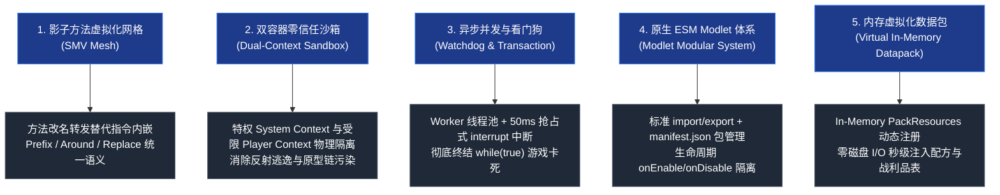

# 新一代架构技术蓝图索引 (New Base Architecture)

欢迎查阅 **Graal-Agent 新一代架构终极生产级技术蓝图 (New Base Architecture Specification)**。

本技术体系是基于对前代原型系统（参见 [[Architecture-Review-and-Improvement|架构审查与改进报告]]）的深度代码审查与痛点反思，在“思维实验”中达致最佳工程状态的全套全新设计规范。本蓝图确立了针对现代 Minecraft（26+ 无符号混淆版本）的零侵入式、企业级可靠的 JavaScript/Polyglot 脚本运行环境标准。

---

## 核心设计支柱 (Architectural Pillars)

---

## 规范文档矩阵与模块导航

本知识库完全遵循 **Wiki-Markdown** 体系，所有模块均通过双向链接深入互联：

### 一、顶层设计与宏观蓝图
- [[Vision-and-Principles]]：新一代系统愿景、设计哲学、反脆弱理念与零侵入准则。
- [[System-Architecture]]：系统五层微内核拓扑、领域模型边界与全局运行全景图。

### 二、底层插桩与类加载解耦
- [[Module-Bootstrap]]：现代化 Agent 引导装载、System ClassLoader 依赖注入与 Bundler 解耦。
- [[Module-SMV-Mesh]]：基于 JDK 22+ Class-File API 的 [[Shadow-Method-Virtualization|影子方法虚拟化 (SMV)]] 规范，彻底重构字节码织入机制。

### 三、桥接分发与指令网关
- [[Module-Bridge-and-Dispatcher]]：统一跨端环境抽象、`MethodHandle` 高速反射缓存池与 `BrigadierAdapter` 零代码重复指令网关。

### 四、Polyglot 引擎与高可用并发
- [[Module-DualContext-Engine]]：特权与零信任双容器架构、GraalVM 隔离池与 **防 `while(true)` 异步看门狗抢占中断** 规范。
- [[Module-Concurrency-and-Events]]：无锁事件总线（EventBus）、非阻塞任务调度与主线程事务缓冲队列（MainThread Transaction Buffer）。

### 五、脚本模块化生态与原生数据包
- [[Module-ESM-Modlet-System]]：ECMAScript 标准模块（ESM）加载器、Modlet 包规范与沙箱作用域隔离。
- [[Module-Virtual-Datapack]]：内存虚拟化数据包（Virtual In-Memory Pack）与物理混合加载管线。

### 六、安全合规与系统可观测性
- [[Module-Security-Specification]]：不可伪造的 `SecurityContext` 闭包令牌、显式能力白名单（Capability Token）与防异步逃逸规范。
- [[Module-Diagnostics-and-Logging]]：结构化遥测、多通道日志汇聚与崩溃快照转储。

### 七、演进路线与迁移计划
- [[Refactoring-and-Migration-Plan]]：从旧有 `src` 代码平滑重构成新架构的六阶段实施指南与兼容适配垫片。

---

## 与前代架构的核心演进对比

| 核心维度 | 前代原型实现 (`src/` 现状) | 新一代技术蓝图 (`docs/new_base/`) |
| :--- | :--- | :--- |
| **字节码注入** | 巨石单类 `MinecraftTransformer`，硬编码底层字节码指令 | [[Module-SMV-Mesh\|SMV 影子网格]]：方法重命名隔离 + 虚拟转发桩 |
| **指令系统** | 客户端/服务端大面积重复 Brigadier 动态反射与代理 | [[Module-Bridge-and-Dispatcher\|BrigadierAdapter]]：统一 DSL 门面，零重复代码 |
| **反射效率** | 高频路径反复 `Class.forName` / `getMethod` | [[Module-Bridge-and-Dispatcher\|ReflectionCache]]：MethodHandle 预解析内联 |
| **脚本容器** | 单一共享 Context，粗粒度 ThreadLocal 沙箱标记 | [[Module-DualContext-Engine\|双容器隔离]]：特权系统环境与零信任玩家沙箱物理隔离 |
| **死循环防御** | `while(true)` 瞬间冻结游戏主线程或导致 Watchdog Crash | [[Module-DualContext-Engine\|异步 Worker + 超时抢占中断]]：50ms 熔断，主线程零卡顿 |
| **异步安全性** | `setTimeout` 异步回调不受沙箱标记保护，直接逃逸 | [[Module-Security-Specification\|闭包安全令牌]]：任务创建时快照状态，随线程传递 |
| **模块生态** | 单目录扁平加载，按文件名排序，污染全局作用域 | [[Module-ESM-Modlet-System\|标准 ESM + Modlet]]：独立包目录、manifest.json 与生命周期 |
| **数据包联动** | 纯磁盘文件生成写入，易造成 I/O 碎片与延迟 | [[Module-Virtual-Datapack\|双模管线]]：支持内存虚拟包直接挂载，零磁盘读写注入 |
| **代码组织** | `ScriptManager` 承担 10+ 职责的上帝类，锁死主线程 | [[System-Architecture\|微内核解耦]]：Facade 门面 + 专用独立服务组件，读写锁隔离 |

---

## 快速入口

- 探索设计理念：请阅读 **[[Vision-and-Principles]]**
- 查阅完整拓扑：请阅读 **[[System-Architecture]]**
- 了解死循环与并发破局点：请阅读 **[[Module-DualContext-Engine]]**
- 查阅字节码革命方案：请阅读 **[[Module-SMV-Mesh]]**
