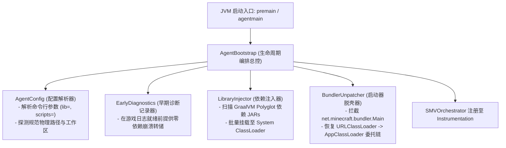

# 模块规范：引导装载与类加载脱壳 (Bootstrap)

本模块规范重构前代 [`AgentMain.java`](file:///H:/mc-mod/graal-agent/src/com/graalagent/AgentMain.java)，建立高健壮性、防御式探测、配置解耦的下一代 JVM 引导装载架构。

---

## 模块架构与职责解耦

前代 `AgentMain` 内部混杂了路径推导、JAR 文件扫描、Logger 初始化、系统类加载器追加、参数解析与 Transformer 注册。
新一代规范将其彻底拆分为四个专用组件：



---

## 核心组件技术实现规范

### 1. 结构化配置解析器 (`AgentConfig`)
替代前代原生的硬编码路径拼接，采用强类型只读配置对象：

```java
public record AgentConfig(
        Path agentJarPath,
        Path agentDir,
        Path scriptsDir,
        Path libDir,
        Path logFilePath,
        boolean debugMode
) {
    public static AgentConfig parse(String agentArgs, Path agentJarLocation) {
        // 1. 标准化 agent 根路径
        Path baseDir = (agentJarLocation != null && agentJarLocation.getParent() != null)
                ? agentJarLocation.getParent().toAbsolutePath().normalize()
                : Paths.get(".").toAbsolutePath().normalize();

        // 2. 解析参数键值对
        Map<String, String> params = parseArgs(agentArgs);

        // 3. 决议候选工作区
        Path scripts = resolvePath(params.get("scripts"), baseDir.resolve("scripts"));
        Path lib = resolvePath(params.get("lib"), baseDir.resolve("lib"));
        Path log = resolvePath(params.get("log"), baseDir.resolve("agent.log"));
        boolean debug = Boolean.parseBoolean(params.getOrDefault("debug", "false"));

        return new AgentConfig(agentJarLocation, baseDir, scripts, lib, log, debug);
    }
}
```

### 2. 依赖注入器 (`LibraryInjector`)
GraalVM Truffle 引擎对于运行时符号的依赖十分严苛。如果某个依赖缺失，引擎在编译期可能不报错，但在执行复杂 JS 特性时抛出未预期的 `NoClassDefFoundError`。

新规范引入**确定性依赖校验（Deterministic Dependency Verification）**：
1. **核心依赖清单核验**：
   预定义关键特征类签名（如 `org.graalvm.polyglot.Context`, `com.oracle.truffle.api.Truffle`, `com.ibm.icu.text.DateFormat`）。
2. **挂载后反射探测**：
   挂载完成后，立即尝试通过 `ClassLoader.getSystemClassLoader().loadClass(...)` 测试装载关键类。若缺少任何关键类，在启动第一毫秒立即以高可读性错误框提示，杜绝游戏启动后中途崩溃。

### 3. Bundler 脱壳与类加载委托链修复 (`BundlerUnpatcher`)
现代 Minecraft 官方发布包使用 Bundler 机制：
- `net.minecraft.bundler.Main` 使用私有 `URLClassLoader` 载入提取出的游戏主包；
- 原版代码在构造此类加载器时，主动调用 `ClassLoader.getPlatformClassLoader()` 或将父级截断为 `null`；
- 这导致游戏内部代码向上回溯时无法穿透到 `AppClassLoader`（系统类加载器），因而无法“看见”通过 `appendToSystemClassLoaderSearch` 挂载的 Agent 类。

#### 修复原理规范
通过在 `SMVOrchestrator` 中拦截 `net/minecraft/bundler/Main`：
1. 匹配其 `run([Ljava/lang/String;)V` 方法中的 `invokevirtual java/lang/ClassLoader.getParent()` 调用指令；
2. 消除截断逻辑，强制将 `AppClassLoader`（即 `ClassLoader.getSystemClassLoader()`）作为其父类加载器传入；
3. **效果**：Minecraft 运行时的所有游戏类和数据包类均能透明访问 `com.graalagent.*` 命名空间及 GraalVM 运行时。

---

## 接口契约规范

```java
package com.graalagent.bootstrap;

import java.lang.instrument.Instrumentation;

public final class AgentBootstrap {
    private static volatile AgentConfig configuration;
    private static volatile boolean initialized = false;

    public static void premain(String agentArgs, Instrumentation inst) {
        bootstrap("premain", agentArgs, inst);
    }

    public static void agentmain(String agentArgs, Instrumentation inst) {
        bootstrap("agentmain", agentArgs, inst);
    }

    private static synchronized void bootstrap(String mode, String args, Instrumentation inst) {
        if (initialized) return;
        // 编排组件执行...
        initialized = true;
    }

    public static AgentConfig getConfiguration() {
        return configuration;
    }
}
```

---

## 相关文档双链

- [[Index]] - 返回技术蓝图索引
- [[System-Architecture]] - 查看系统分层拓扑
- [[Module-SMV-Mesh]] - 深入影子方法虚拟化
- [[Module-Diagnostics-and-Logging]] - 深入早期诊断日志
