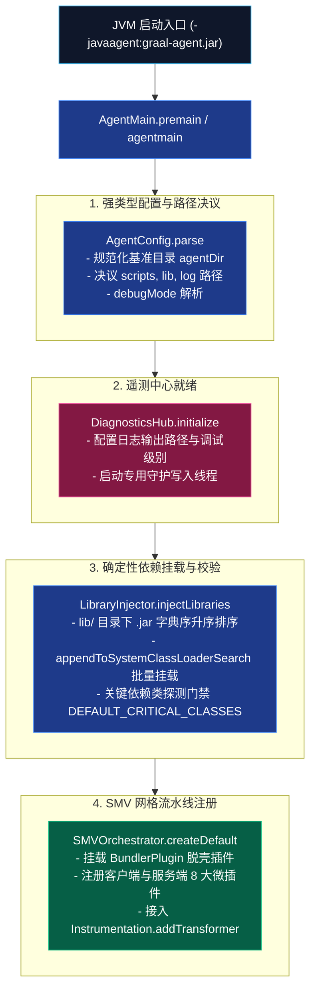

# 模块规范与实现：引导装载与类加载脱壳 (Bootstrap)

本模块规范整合了早期引导架构设计与 **Track 1 (`phase1_foundation_infra_20261103`)**、**Track 2 (`phase2_smv_bytecode_mesh_20261103`)** 所交付的生产级实现。它彻底消除了历史实现中硬编码字符串路径拼接、依赖加载随机无序、缺失 GraalVM 关键依赖时静默故障以及 Minecraft Bundler 启动器对系统类加载器的人工截断问题。

---

## 🧭 源码与测试工程导航

- **不可变强类型配置 Record**：[`src/com/graalagent/bootstrap/AgentConfig.java`](../../src/com/graalagent/bootstrap/AgentConfig.java)
- **依赖注入与确定性校验器**：[`src/com/graalagent/bootstrap/LibraryInjector.java`](../../src/com/graalagent/bootstrap/LibraryInjector.java)
- **Bundler 启动器脱壳微插件**：[`src/com/graalagent/transformer/plugins/BundlerPlugin.java`](../../src/com/graalagent/transformer/plugins/BundlerPlugin.java)
- **Agent 主入口与编排器**：[`src/com/graalagent/AgentMain.java`](../../src/com/graalagent/AgentMain.java)
- **引导层离线自动化测试**：[`test/com/graalagent/bootstrap/BootstrapTest.java`](../../test/com/graalagent/bootstrap/BootstrapTest.java) 及 [`test/com/graalagent/bootstrap/AgentMainBootstrapTest.java`](../../test/com/graalagent/bootstrap/AgentMainBootstrapTest.java)

---

## 🏗️ 引导阶段全景架构拓扑



---

## ⚙️ 核心数据模板与 API 接口契约

### 1. 不可变强类型配置数据模板 (`AgentConfig`)

系统淘汰旧版动态硬编码路径，采用不可变 Java 16+ Record 作为全局只读配置载体：

```java
package com.graalagent.bootstrap;

import java.nio.file.Path;

/**
 * 强类型不可变引导配置模型
 *
 * @param agentJarPath  Agent JAR 自身绝对路径
 * @param agentDir      Agent 所在父目录（基准目录）
 * @param scriptsDir    用户 JS 脚本与 Modlet 工作区目录（默认 agentDir/scripts）
 * @param libDir        GraalVM 运行时与依赖库目录（默认 agentDir/lib）
 * @param logFilePath   诊断日志输出物理路径（默认 agentDir/agent.log）
 * @param debugMode     是否开启纳秒级调试遥测
 */
public record AgentConfig(
        Path agentJarPath,
        Path agentDir,
        Path scriptsDir,
        Path libDir,
        Path logFilePath,
        boolean debugMode
) {
    /**
     * 解析命令行参数并结合 Agent 所在物理位置安全决议全量路径
     *
     * @param agentArgs        逗号分隔的命令行参数 (如 "scripts=my_scripts,lib=my_lib,debug=true")
     * @param agentJarLocation AgentMain 检测到的自身物理定位
     * @return 经过规范化校验的不可变配置实例
     */
    public static AgentConfig parse(String agentArgs, Path agentJarLocation) {
        // 实现详见 src/com/graalagent/bootstrap/AgentConfig.java
    }
}
```

#### 启动参数语法规范
支持在 JVM 启动参数 `-javaagent:graal-agent.jar=<args>` 中传入以逗号分隔的键值对：
- `scripts=<path>`：自定义脚本根目录（支持绝对路径或基于 `agentDir` 的相对路径）；
- `lib=<path>`：自定义依赖库目录；
- `log=<path>`：自定义日志落盘文件路径；
- `debug=true|false`：开启或关闭详细调试日志。

---

### 2. 依赖注入与确定性校验 API 契约 (`LibraryInjector`)

为确保 GraalVM Truffle 引擎跨平台类加载顺序一致，并杜绝缺失关键依赖时的静默故障，[`LibraryInjector`](../../src/com/graalagent/bootstrap/LibraryInjector.java) 确立了如下生产级 API 接口：

```java
package com.graalagent.bootstrap;

import java.lang.instrument.Instrumentation;
import java.nio.file.Path;
import java.util.List;

public class LibraryInjector {

    /** 核心基石依赖类探测探针清单 */
    public static final List<String> DEFAULT_CRITICAL_CLASSES = List.of(
            "org.graalvm.polyglot.Context",
            "com.oracle.truffle.api.Truffle"
    );

    /**
     * 极速无副作用类存在性探测（initialize = false，杜绝触发 static 块）
     */
    public static boolean verifyClassPresent(String className, ClassLoader cl);

    /**
     * 依赖门禁探测：检查指定类名集合在指定类加载器中的存在性，返回缺失的类名列表
     */
    public static List<String> checkDependencies(ClassLoader cl, List<String> classNames);

    /**
     * 依赖包字典序确定性批量挂载至 System ClassLoader
     *
     * @param libDir 依赖 JAR 物理目录
     * @param inst   JVM Instrumentation 句柄
     * @return 成功挂载的 JAR 文件数量
     */
    public static int injectLibraries(Path libDir, Instrumentation inst);
}
```

---

### 3. Bundler 脱壳与类加载委托链修复 (`BundlerPlugin`)

自 Minecraft 1.18 起，官方发布包内置了 `net.minecraft.bundler.Main`：
1. 原版启动器创建私有 `URLClassLoader` 载入提取出的游戏主 JAR；
2. 在调用构造方法时，原版逻辑主动通过 `ClassLoader.getParent()` 截断父类加载器，将其置为 `PlatformClassLoader`；
3. 这导致游戏内部运行的所有类在向上查找父类时，完全绕过了系统类加载器（`AppClassLoader`），从而无法“看见”挂载在 Agent 上的 GraalVM 类与 `com.graalagent.*` 符号。

#### 3.1 解决方案：标称类型 Class-File API 指令切除
在新一代微内核插件流水线中，通过专用微插件 [`BundlerPlugin`](../../src/com/graalagent/transformer/plugins/BundlerPlugin.java) 拦截目标类 `net.minecraft.bundler.Main` 的入口方法 `void run(String[] args)`，完全遵循 **JDK 24+ Nominal Typing First** 标准：

```java
package com.graalagent.transformer.plugins;

import com.graalagent.transformer.ClassTransformPlugin;
import java.lang.classfile.*;
import java.lang.classfile.instruction.InvokeInstruction;
import java.lang.constant.ClassDesc;
import java.lang.constant.ConstantDescs;
import java.lang.constant.MethodTypeDesc;

public class BundlerPlugin implements ClassTransformPlugin {
    public static final String TARGET_CLASS = "net/minecraft/bundler/Main";

    private static final ClassDesc CD_CLASS_LOADER = ClassDesc.of("java.lang.ClassLoader");
    private static final MethodTypeDesc MTD_RUN = MethodTypeDesc.of(
            ConstantDescs.CD_void, ConstantDescs.CD_String.arrayType());

    @Override
    public String getTargetClassName() {
        return TARGET_CLASS;
    }

    @Override
    public ClassTransform asClassTransform(ClassModel classModel) {
        return (builder, element) -> {
            // 标称类型精准匹配: void run(String[] args)
            if (element instanceof MethodModel mm
                    && mm.methodName().equalsString("run")
                    && mm.methodTypeSymbol().equals(MTD_RUN)) {

                builder.transformMethod(mm, MethodTransform.transformingCode((cb, ce) -> {
                    // 标称类型匹配: invokevirtual ClassLoader.getParent()
                    if (ce instanceof InvokeInstruction inv
                            && inv.owner().asSymbol().equals(CD_CLASS_LOADER)
                            && inv.name().equalsString("getParent")) {
                        // 抛弃 getParent 调用，URLClassLoader 直接继承当前 AppClassLoader!
                        return;
                    }
                    cb.with(ce);
                }));
                return;
            }
            builder.with(element);
        };
    }
}
```

- **成效**：Minecraft 运行时的所有游戏类和数据包类均能透明访问系统类加载器内的全部类，彻底瓦解了 Bundler 隔离壁垒。

---

## 🧪 验证与测试覆盖

单元测试位于 [`test/com/graalagent/bootstrap/BootstrapTest.java`](../../test/com/graalagent/bootstrap/BootstrapTest.java) 与 [`test/com/graalagent/bootstrap/AgentMainBootstrapTest.java`](../../test/com/graalagent/bootstrap/AgentMainBootstrapTest.java)，验证指标如下：
1. **默认路径决议**：验证无外部参数传入时，系统自适应定位到 Agent 所在目录同级的 `scripts/`、`lib/` 与 `agent.log`；
2. **命令行解析健壮性**：验证逗号分隔字符串的健壮解析能力，键名不区分大小写，布尔值准确决议；
3. **确定性关键类验证**：验证系统类加载器中 GraalVM 关键依赖类的探针逻辑；
4. **缺失依赖精准感知**：验证模拟缺失类时能准确返回缺失类名列表；
5. **Agent 引导与异常转储挂载**：验证 `AgentMain` 启动时参数解析与 `DiagnosticsHub` 联通，以及未捕获异常自动触发 `CrashDumpRecorder` 落盘快照。

---

## 🔗 相关导航
- 蓝图总索引：[[Index|新一代架构技术蓝图索引]]
- 核心术语：[[Terminology-and-Concepts|核心术语与物理概念体系]]
- 字节码网格：[[Module-SMV-Mesh|影子方法虚拟化网格规范]]
- 遥测引擎：[[Module-Diagnostics-and-Logging|结构化遥测与多维日志诊断]]
- 验证套件：[[Verification-and-Testing|自动化测试套件与实机验证]]
