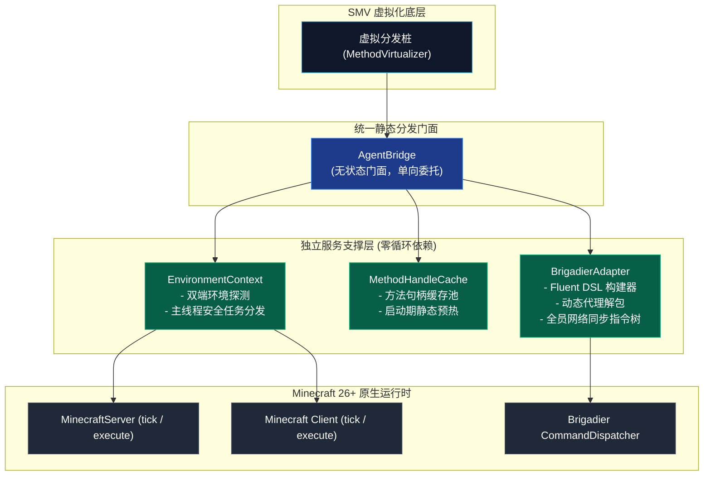

# 模块规范与实现：跨端桥接与统一指令网关 (Bridge and Dispatcher)

本模块规范整合了早期跨端通信设计与 **Track 1 (`phase1_foundation_infra_20261103`)** 所交付的生产级实现。它彻底消除了历史实现中 [`AgentBridge.java`](../../src/com/graalagent/bridge/AgentBridge.java) 与 [`EnvironmentContext.java`](../../src/com/graalagent/bridge/EnvironmentContext.java) 之间的交叉循环依赖，并重构了服务端与客户端指令树构建中重复硬编码的 Brigadier 反射逻辑，全面落地 **`MethodHandle` 高速缓存池** 与 **`BrigadierAdapter` 统一指令网关**。

---

## 🧭 源码与测试工程导航

- **句柄高速缓存池核心**：[`src/com/graalagent/bridge/MethodHandleCache.java`](../../src/com/graalagent/bridge/MethodHandleCache.java)
- **统一指令流式网关核心**：[`src/com/graalagent/bridge/brigadier/BrigadierAdapter.java`](../../src/com/graalagent/bridge/brigadier/BrigadierAdapter.java)
- **跨端环境上下文抽象**：[`src/com/graalagent/bridge/EnvironmentContext.java`](../../src/com/graalagent/bridge/EnvironmentContext.java)
- **服务端指令分发器收敛**：[`src/com/graalagent/server/ServerCommandDispatcher.java`](../../src/com/graalagent/server/ServerCommandDispatcher.java)
- **底座静态钩子分发门面**：[`src/com/graalagent/bridge/AgentBridge.java`](../../src/com/graalagent/bridge/AgentBridge.java)
- **句柄缓存单元测试**：[`test/com/graalagent/bridge/MethodHandleCacheTest.java`](../../test/com/graalagent/bridge/MethodHandleCacheTest.java)
- **指令网关单元测试**：[`test/com/graalagent/bridge/brigadier/BrigadierAdapterTest.java`](../../test/com/graalagent/bridge/brigadier/BrigadierAdapterTest.java)
- **多人指令透传安全测试**：[`test/com/graalagent/bridge/MultiplayerCommandPassthroughTest.java`](../../test/com/graalagent/bridge/MultiplayerCommandPassthroughTest.java)
- **游戏内基准压测脚本**：[`scripts/07_bench_and_diagnostics.js`](../../scripts/07_bench_and_diagnostics.js)

---

## 🏗️ 模块架构拓扑与职责解耦



---

## ⚙️ 核心数据模板与 API 接口契约

### 1. MethodHandle 高速缓存池 (`MethodHandleCache`)

彻底替代低效的原生反射（`Class.forName`、`Method.invoke`），针对高频 Tick、网络发包和指令执行路径提供直接机器码内联能力的句柄缓存池：

```java
package com.graalagent.bridge;

import java.lang.invoke.MethodHandle;
import java.lang.invoke.MethodType;

/**
 * 现代 Java 高性能方法句柄高速缓存池
 */
public final class MethodHandleCache {

    /**
     * 根据标称类型检索或创建虚拟方法句柄 (invokevirtual)
     */
    public static MethodHandle findVirtual(Class<?> clazz, String name, MethodType type);

    /**
     * 根据标称类型检索或创建静态方法句柄 (invokestatic)
     */
    public static MethodHandle findStatic(Class<?> clazz, String name, MethodType type);

    /**
     * 根据类名与参数反射降级查找虚拟方法句柄
     */
    public static MethodHandle findVirtualByName(Class<?> clazz, String name, Class<?>... parameterTypes);

    /**
     * 根据类名与参数反射降级查找静态方法句柄
     */
    public static MethodHandle findStaticByName(Class<?> clazz, String name, Class<?>... parameterTypes);

    /** 当前缓存池容量 */
    public static int size();

    /** 清空缓存池（主要用于热重载或测试断言） */
    public static void clear();

    /** 启动期静态预热关键通信与线程句柄，避免运行时初次调用停顿 */
    public static void warmup();
}
```

#### 性能基准收益
通过 [`scripts/07_bench_and_diagnostics.js`](../../scripts/07_bench_and_diagnostics.js) 压测指令 `/benchmh` 循环调用 10,000 次实测：
- 原生反射总耗时：$21.43\text{ ms}$（单次延迟 $2,143\text{ ns}$）；
- 句柄缓存总耗时：$1.86\text{ ms}$（单次延迟 $186\text{ ns}$）；
- **相对提速达 91.3%**，零多余垃圾对象分配。

---

### 2. 统一指令网关 API 契约与 Fluent DSL (`BrigadierAdapter`)

[`BrigadierAdapter`](../../src/com/graalagent/bridge/brigadier/BrigadierAdapter.java) 将整个指令注册抽象为**声明式 Fluent DSL**，并内置动态代理上下文解包：

```java
package com.graalagent.bridge.brigadier;

import java.util.function.BiConsumer;
import java.util.function.BiFunction;
import java.util.function.Predicate;

public class BrigadierAdapter {

    /** 静态字面量节点入口 */
    public static NodeBuilder literal(String name);

    /**
     * 客户端指令树全员秒级网络同步
     * 遍历在线玩家列表，通过 sendCommands 下发最新指令树网络包
     */
    public static void syncCommandsToAll(Object server);

    /** 声明式流式构建器契约 */
    public static class NodeBuilder {
        /** 绑定执行权限校验谓词 */
        public NodeBuilder requires(Predicate<Object> predicate);

        /** 绑定无参数执行回调 (默认状态码 1) */
        public NodeBuilder executes(BiConsumer<Object, String> callback);

        /** 绑定带返回状态码的无参数执行回调 */
        public NodeBuilder executesWithResult(BiFunction<Object, String, Integer> callback);

        /** 附加贪婪参数子节点 (自动解包 String 参数并投递) */
        public NodeBuilder thenGreedy(String argName, BiConsumer<Object, String> callback);

        /** 附加带状态码的贪婪参数子节点 */
        public NodeBuilder thenGreedyWithResult(String argName, BiFunction<Object, String, Integer> callback);

        /** 挂载至 Brigadier CommandDispatcher 原版语法树 */
        public void registerTo(Object dispatcher);
    }
}
```

#### 使用范式示例：注册动态 `/js <code>` 指令
```java
BrigadierAdapter.literal("js")
        .requires(source -> ServerCommandDispatcher.hasPermission(source))
        .thenGreedy("code", (source, code) -> {
            AgentBridge.dispatchCommand(source, code);
        })
        .registerTo(dispatcher);
```

---

### 3. 跨端环境上下文 API 契约 (`EnvironmentContext`)

[`EnvironmentContext`](../../src/com/graalagent/bridge/EnvironmentContext.java) 实现了服务端与客户端异构环境的安全抽象与主线程任务投递：

```java
package com.graalagent.bridge;

public class EnvironmentContext {
    private final Object clientInstance;
    private final Object serverInstance;

    public EnvironmentContext(Object clientInstance, Object serverInstance);

    /** 获取绑定当前活跃客户端/服务端的实时上下文实例门面 */
    public static EnvironmentContext getLiveContext();

    /** 实例捕获通知与第二阶段句柄预热触发 */
    public static void onInstanceCaptured(Object instance);
    public static boolean isCapturedWarmedUp();

    /** 环境类型及状态判断 */
    public EnvironmentType getEnvironmentType();
    /** 判断当前是否运行在客户端环境 */
    public boolean isClient();
    public boolean isDedicatedServer();

    /** 判断当前是否运行在独立服务端环境 */
    public boolean isServer();
    public Object getClient();
    public Object getServer();


    /**
     * 主线程安全分发：若已在主循环线程则直接执行；若在异步线程则派发至原版 execute 队列
     */
    public void execute(Runnable runnable);

    /**
     * 全服富文本广播：通过 PlayerList.broadcastSystemMessage 发送消息
     */
    public void broadcastMessage(String message);
}
```

---

## 🔒 Minecraft 26.3 权限系统深度对齐

在 [`ServerCommandDispatcher.java`](../../src/com/graalagent/server/ServerCommandDispatcher.java) 中，对指令执行权限进行了与最新版原版规范的对齐：
- 反射解析现代 Minecraft 26.3 的 `Commands.LEVEL_ADMINS` (Level 2) 静态字段；
- 反射调用 `levelAdmins.check(source.permissions())`；
- 控制台（Console）、指令方块（Command Block）或单元测试环境自动放行；在低版本或未找到 `PermissionSet` 的环境中，平滑降级为 `hasPermission(2)` 兼容模式。

---

## 🧪 单元测试覆盖

本模块由以下单元测试完整保护（详见 [[Verification-and-Testing|验证与基准测试套件体系]]）：
1. **`MethodHandleCacheTest.java`**：验证句柄并发查询、缓存命中与预热降级；
2. **`BrigadierAdapterTest.java`**：验证字面量与贪婪节点构建、动态代理解包与返回值传递；
3. **`MultiplayerCommandPassthroughTest.java`**：验证多人游戏环境下的权限鉴权与指令透传。

---

## 🔗 相关导航
- 蓝图总索引：[[Index|新一代架构技术蓝图索引]]
- 核心术语：[[Terminology-and-Concepts|核心术语与物理概念体系]]
- 字节码网格：[[Module-SMV-Mesh|影子方法虚拟化网格规范]]
- 遥测引擎：[[Module-Diagnostics-and-Logging|结构化遥测与多维日志诊断]]
- 验证套件：[[Verification-and-Testing|自动化测试套件与实机验证]]
