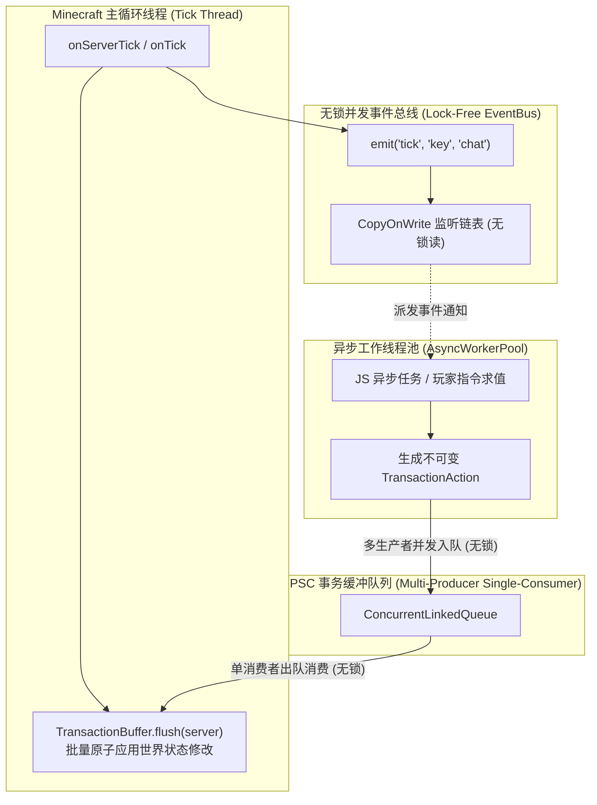
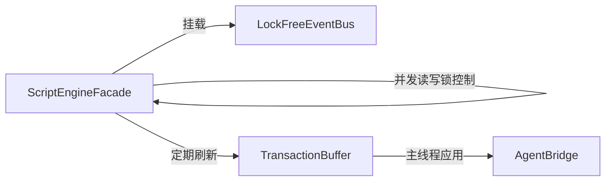

# 模块规范：异步事务缓冲与无锁事件总线 (Concurrency and Events)

在前代原型实现中，全局几乎所有核心方法（`onTick`, `evalSandboxed`, `reload`）都冠以粗暴的 `synchronized` 关键字，导致主游戏循环与后台重载/异步脚本激烈争抢同一把对象监视器锁，极易引发严重掉帧与掉 Tps。

本模块规范重构并发架构，确立 **读写锁分离 (ReadWriteLock Separation)**、**无锁并发事件总线 (Lock-Free EventBus)** 与 **MPSC 主线程事务缓冲队列 (TransactionBuffer)**。

---

## 并发分层拓扑模型



---

## 核心并发机制规范

### 1. 读写锁解耦热重载与游戏心跳
在前代中，文件保存触发 `reload()` 时，会持有 `ScriptManager` 的监视器锁。此时原版 `onTick()` 无法获取锁，整个游戏必须等待所有脚本重新编译完成才能继续下一帧。

新架构采用 `java.util.concurrent.locks.StampedLock` 或 `ReentrantReadWriteLock`：

```java
public class ScriptEngineFacade {
    private final ReentrantReadWriteLock rwLock = new ReentrantReadWriteLock();
    private final Lock readLock = rwLock.readLock();
    private final Lock writeLock = rwLock.writeLock();

    // 每刻游戏主循环 Tick (超高频，只获取共享读锁)
    public void onTick() {
        if (!readLock.tryLock()) {
            // 若恰逢极短暂的热重载写锁占用，立即跳过本次 Tick 派发，绝不挂起游戏主线程！
            return;
        }
        try {
            eventBus.emit("tick");
        } finally {
            readLock.unlock();
        }
    }

    // 脚本热重载 (低频，排他写锁)
    public void reload() {
        writeLock.lock();
        try {
            // 毫秒级重置 Context 引用与状态...
        } finally {
            writeLock.unlock();
        }
    }
}
```

通过这一改造，热重载期间主线程绝不发生阻塞卡死，最多仅短暂略过 1~2 个 Tick 的脚本事件，保证玩家画面绝对流畅。

### 2. MPSC 事务缓冲队列 (`TransactionBuffer`)
为了保证异步线程执行的代码能够安全修改 Minecraft 内部状态（如方块、实体、背包），系统采用**多生产者单消费者（MPSC）无锁队列**：

```java
public final class TransactionBuffer {
    private static final Queue<TransactionAction> QUEUE = new ConcurrentLinkedQueue<>();
    private static final int MAX_BATCH_PER_TICK = 1000; // 单 Tick 最大处理阈值，防止卡死

    // 供任意异步 Worker 线程无锁调用
    public static void enqueue(TransactionAction action) {
        if (action != null) {
            QUEUE.offer(action);
        }
    }

    // 仅在 Minecraft 主线程的 Tick 边界调用
    public static void flush(Object server) {
        int processed = 0;
        TransactionAction action;
        // 批量消费并在主线程执行真实 Minecraft API
        while (processed < MAX_BATCH_PER_TICK && (action = QUEUE.poll()) != null) {
            try {
                action.apply(server);
                processed++;
            } catch (Throwable t) {
                Logger.error("Failed to apply transaction action: " + action, t);
            }
        }
    }
}
```

#### 典型 `TransactionAction` 接口与实现
```java
@FunctionalInterface
public interface TransactionAction {
    void apply(Object serverContext) throws Exception;
}

// 示例：给予玩家物品事务
public record GiveItemAction(UUID playerUUID, String itemId, int count) implements TransactionAction {
    @Override
    public void apply(Object serverContext) {
        // 在主线程执行原版 /give 或实体背包 API
    }
}
```

### 3. 无锁并发事件总线 (`LockFreeEventBus`)
事件总线是高频通信的心脏。新规范要求：
1. **监听器链表采用 `CopyOnWriteArrayList`**：
   事件发布（`emit`）操作为纯只读遍历，完全无需加锁，具备最高读取并发度；
2. **事件优先级支持（Event Priority）**：
   支持 `LOWEST`, `NORMAL`, `HIGH`, `MONITOR` 四级优先级，确保拦截型插件先于统计型插件处理；
3. **取消状态传播（Cancellable Event）**：
   按键、聊天与指令事件携带 `isCancelled()` 标记。一旦某个优先级的回调将其取消，后续回调及原版逻辑自动短路。

---

## 模块协作关系



---

## 相关文档双链

- [[Index]] - 返回技术蓝图索引
- [[System-Architecture]] - 查看系统分层拓扑
- [[Module-DualContext-Engine]] - 深入双容器与看门狗抢占机制
- [[Module-ESM-Modlet-System]] - 深入 ESM 模块系统
- [[Module-Security-Specification]] - 深入安全事务边界
