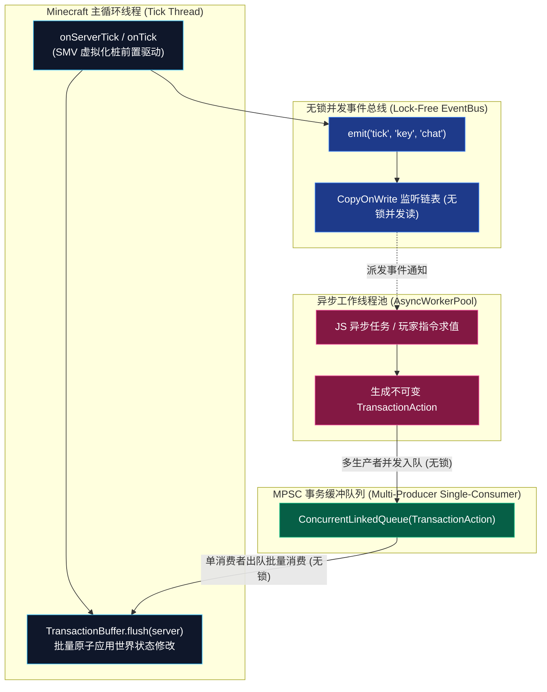

# 模块规范：异步事务缓冲与无锁事件总线 (Concurrency and Events)

在前代原型实现中，全局几乎所有核心方法（`onTick`、`evalSandboxed`、`reload`）都冠以粗暴的 `synchronized` 关键字，导致主游戏循环与后台重载/异步脚本激烈争抢同一把对象监视器锁，极易引发严重掉帧与掉 TPS。

本模块规范重构并发架构，确立 **读写锁分离 (ReadWriteLock Separation)**、**无锁并发事件总线 (Lock-Free EventBus)** 与 **MPSC 主线程事务缓冲队列 (TransactionBuffer)**。

---

## 🏗️ 并发分层拓扑模型



---

## ⚙️ 核心数据模板与 API 接口契约

### 1. 读写锁解耦热重载与游戏心跳

采用 `java.util.concurrent.locks.ReentrantReadWriteLock`：
- **每刻游戏主循环 Tick (超高频读锁)**：在执行心跳派发时仅尝试获取共享读锁（`readLock.tryLock()`）。若恰逢极短暂的热重载写锁占用，立即跳过本次 Tick 派发，绝不挂起游戏主线程；
- **脚本热重载 (低频排他写锁)**：获取独占写锁（`writeLock.lock()`），毫秒级重置 Context 引用与状态；
- **成效**：热重载期间主线程绝不发生阻塞卡死，最多仅短暂略过 1~2 个 Tick 的脚本事件，保证玩家画面绝对流畅。

```java
package com.graalagent.concurrency;

import java.util.concurrent.locks.Lock;
import java.util.concurrent.locks.ReentrantReadWriteLock;

public class ConcurrencyController {
    private final ReentrantReadWriteLock rwLock = new ReentrantReadWriteLock();
    private final Lock readLock = rwLock.readLock();
    private final Lock writeLock = rwLock.writeLock();

    public boolean tryExecuteTickRead(Runnable tickAction) {
        if (!readLock.tryLock()) {
            return false; // 热重载期间安全跳过，绝不阻塞游戏主线程!
        }
        try {
            tickAction.run();
            return true;
        } finally {
            readLock.unlock();
        }
    }

    public void executeExclusiveReload(Runnable reloadAction) {
        writeLock.lock();
        try {
            reloadAction.run();
        } finally {
            writeLock.unlock();
        }
    }
}
```

---

### 2. MPSC 主线程事务缓冲数据模板与 API (`TransactionBuffer`)

为了保证异步线程执行的代码能够安全修改 Minecraft 内部状态（如方块、实体、背包），系统采用**多生产者单消费者（MPSC）无锁队列**：

#### 2.1 事务动作契约与不可变数据模型 (`TransactionAction`)

```java
package com.graalagent.concurrency;

import java.util.UUID;

/**
 * 不可变事务动作契约：封装对游戏世界的原子写操作
 */
@FunctionalInterface
public interface TransactionAction {
    /** 在主循环线程安全执行原生 API 调用 */
    void apply(Object serverContext) throws Exception;
}

/** 实体位移事务数据载体 */
public record TeleportAction(
        UUID playerUUID,
        double x, double y, double z,
        float yaw, float pitch
) implements TransactionAction {
    @Override
    public void apply(Object serverContext) {
        // 主线程调用 player.teleportTo(x, y, z)
    }
}

/** 物品给予事务数据载体 */
public record GiveItemAction(
        UUID playerUUID,
        String itemId,
        int count
) implements TransactionAction {
    @Override
    public void apply(Object serverContext) {
        // 主线程调用 player.getInventory().add(...)
    }
}

/** 方块修改事务数据载体 */
public record SetBlockAction(
        String dimension,
        int x, int y, int z,
        String blockState
) implements TransactionAction {
    @Override
    public void apply(Object serverContext) {
        // 主线程调用 level.setBlock(pos, state, 3)
    }
}
```

#### 2.2 事务缓冲队列 API 契约 (`TransactionBuffer`)

```java
package com.graalagent.concurrency;

import java.util.Queue;
import java.util.concurrent.ConcurrentLinkedQueue;

public final class TransactionBuffer {
    private static final Queue<TransactionAction> QUEUE = new ConcurrentLinkedQueue<>();
    private static final int MAX_BATCH_PER_TICK = 1000; // 单 Tick 最大消费上限

    /** 供任意异步 Worker 线程无锁并发入队 (耗时 < 10ns) */
    public static void enqueue(TransactionAction action) {
        if (action != null) {
            QUEUE.offer(action);
        }
    }

    /** 仅在 Minecraft Server 主心跳边界调用，批量原子消费 */
    public static int flush(Object serverContext) {
        int processed = 0;
        TransactionAction action;
        while (processed < MAX_BATCH_PER_TICK && (action = QUEUE.poll()) != null) {
            try {
                action.apply(serverContext);
                processed++;
            } catch (Throwable t) {
                // 捕获异常，绝不中断后续事务执行与游戏循环
            }
        }
        return processed;
    }

    /** 待处理事务总数 */
    public static int size() {
        return QUEUE.size();
    }

    /** 清空事务缓冲队列 */
    public static void clear() {
        QUEUE.clear();
    }
}
```

---

### 3. 无锁并发事件总线数据模板与 API (`LockFreeEventBus`)

```java
package com.graalagent.event;

public class LockFreeEventBus {

    public enum EventPriority {
        LOWEST, NORMAL, HIGH, MONITOR
    }

    public interface Cancellable {
        boolean isCancelled();
        void setCancelled(boolean cancelled);
    }

    @FunctionalInterface
    public interface EventListener<T> {
        void onEvent(T event) throws Exception;
    }

    /** 注册指定事件类型的优先级监听器 (基于 CopyOnWriteArrayList) */
    public <T> void register(Class<T> eventType, EventPriority priority, EventListener<T> listener);

    /** 注销监听器 */
    public <T> void unregister(Class<T> eventType, EventListener<T> listener);

    /** 无锁并发派发事件（读线程零加锁，支持 Cancellable 短路） */
    public <T> boolean emit(T event);
}
```

---

## 🔗 相关导航
- 蓝图总索引：[[Index|新一代架构技术蓝图索引]]
- 核心术语：[[Terminology-and-Concepts|核心术语与物理概念体系]]
- 双容器引擎：[[Module-DualContext-Engine|双容器隔离引擎与看门狗抢占机制]]
- 模块生态：[[Module-ESM-Modlet-System|标准 ESM 运行时与 Modlet 体系]]
- 安全规范：[[Module-Security-Specification|闭包安全令牌与零信任沙箱规范]]
