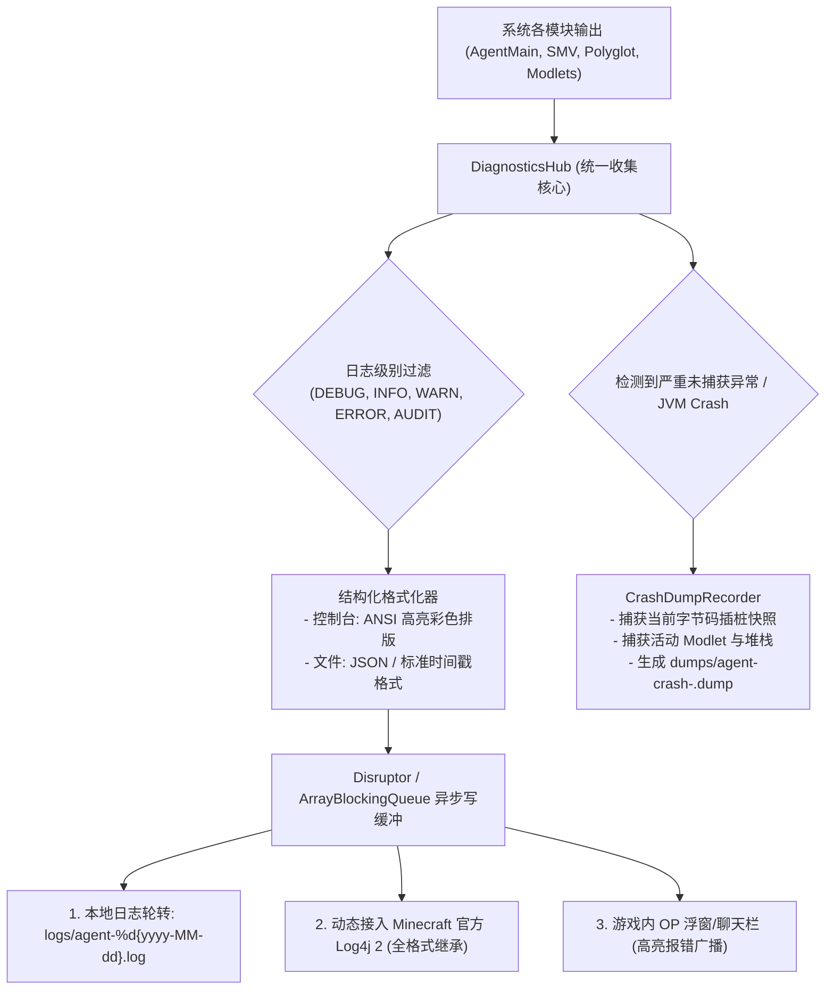

# 模块规范：结构化遥测与多维日志诊断 (Diagnostics and Logging)

本模块规范重构前代简陋的静态 [`Logger.java`](file:///H:/mc-mod/graal-agent/src/com/graalagent/util/Logger.java)，建立一套涵盖**结构化日志（Structured Logging）**、**高性能异步落盘**、**动态 Log4j2 深度桥接**以及**自动故障现场快照转储（Crash Dump Recorder）**的高可观测性系统。

---

## 诊断遥测体系全景拓扑



---

## 核心技术与落地规范

### 1. 结构化日志与多通道异步流
为了防止大量日志 I/O 阻塞主线程或异步 Worker，所有日志输出均通过线程安全的无锁队列投递给后台专用日志守护线程：
- **控制台渲染**：根据严重级别自动匹配 ANSI 终端着色（`INFO` 绿色、`WARN` 金黄、`ERROR` 鲜红、`AUDIT` 紫色）；
- **专用文件通道**：自动按天轮转归档，并在启动时保留历史日志；
- **Log4j 2 深度融合**：通过预解析的方法句柄将消息转发入原版日志管线，天然进入 Minecraft 服务端 `logs/latest.log` 和客户端启动器控制台，无缝享受启动器的日志搜索与着色。

### 2. 崩溃快照记录器 (`CrashDumpRecorder`)
当 Agent 遭遇严重未捕获异常（例如某个 Modlet 发生非法操作，或 Class-File API 在处理奇特 Mod 字节码时解析失败）：
系统会自动收集环境诊断数据并持久化到独立转储文件：

```text
================================================================================
GRAAL-AGENT CRASH DUMP REPORT - 2026-11-03 00:23:45
================================================================================
Runtime Environment:
  Minecraft Version: 26.3
  Java Version: Eclipse Adoptium OpenJDK 22.0.2
  Operating System: Windows 11 (amd64)

Agent & Engine State:
  Active Modlets: [magic_system (v1.0.0), custom_boss (v2.1.0)]
  Active Watchdogs: 0
  System Context State: READY
  Sandbox Pool Available: 4 / 4

Exception Information:
  java.lang.NullPointerException: Cannot invoke "Object.toString()" because "..."
    at com.graalagent.modlet.ModletManager.enable(...) ~[graal-agent.jar]
    at com.graalagent.engine.ScriptEngineFacade.reload(...) ~[graal-agent.jar]

Bytecode Instrumentation Stack:
  Last Transformed Class: net.minecraft.client.KeyboardHandler
  Plugin: KeyboardHandlerPlugin (SMV Virtualized: $$shadow$keyPress)
================================================================================
```
这使得无论是开发者调试还是终端用户汇报 Bug，都能凭借一份转储文件在数秒内精确定位根因。

### 3. 运行指标遥测 (Telemetry Metrics)
提供给脚本开发者或管理员一套轻量级的运行健康度指标：
- `tps`：通过主心跳监测的平滑 TPS 计算；
- `script_eval_latency_p99`：P99 脚本执行耗时监控；
- `active_timers_count`：当前活跃的定时器任务总数；
- `datapack_reload_latency`：虚拟数据包重载耗时统计。

可通过指令 `/js agent.diagnostics.dumpMetrics()` 直接在控制台打印排查性能瓶颈。

---

## 相关文档双链

- [[Index]] - 返回技术蓝图索引
- [[System-Architecture]] - 查看系统分层拓扑
- [[Module-Security-Specification]] - 深入安全审计集成
- [[Module-DualContext-Engine]] - 深入引擎异常捕获
- [[Refactoring-and-Migration-Plan]] - 迁移重构实施规划
