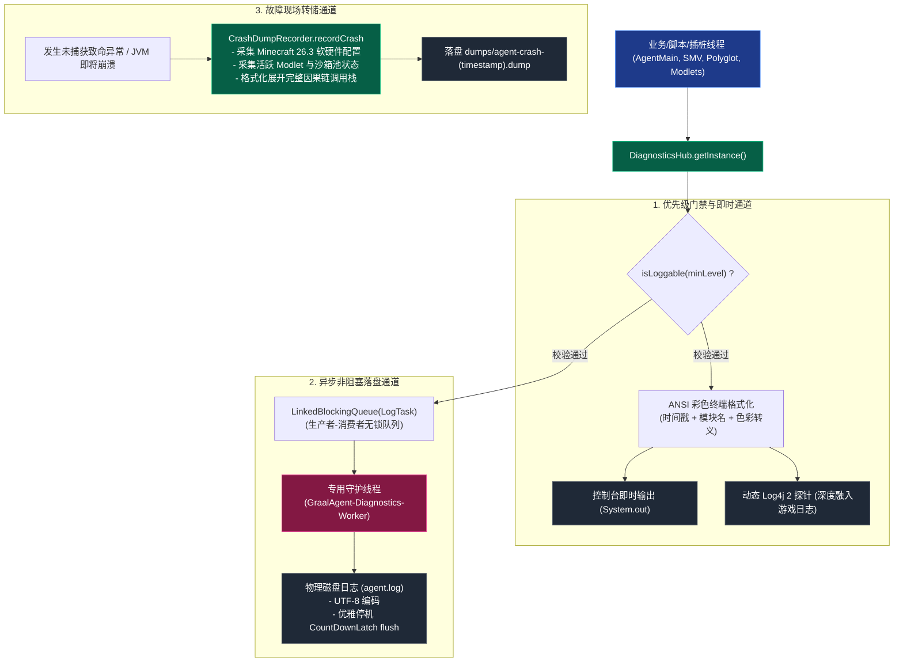

# 模块规范与实现：结构化遥测与多维日志诊断 (Diagnostics and Logging)

本模块规范整合了早期系统遥测设计与 **Track 1 (`phase1_foundation_infra_20261103`)** 所交付的生产级实现。它彻底淘汰了旧版基于单体静态类同步写文件的粗暴方案，全面落地**多级别结构化日志（LogLevel）**、**非阻塞异步写缓冲（DiagnosticsHub）**、**动态 Log4j 2 双向桥接**以及**生产级故障现场快照转储（CrashDumpRecorder）**。

---

## 🧭 源码与测试工程导航

- **统一遥测中心核心**：[`src/com/graalagent/diagnostics/DiagnosticsHub.java`](../../src/com/graalagent/diagnostics/DiagnosticsHub.java)
- **结构化日志级别枚举**：[`src/com/graalagent/diagnostics/LogLevel.java`](../../src/com/graalagent/diagnostics/LogLevel.java)
- **系统故障现场转储器**：[`src/com/graalagent/diagnostics/CrashDumpRecorder.java`](../../src/com/graalagent/diagnostics/CrashDumpRecorder.java)
- **向后兼容静态门面**：[`src/com/graalagent/util/Logger.java`](../../src/com/graalagent/util/Logger.java)
- **遥测中心离线单元测试**：[`test/com/graalagent/diagnostics/DiagnosticsTest.java`](../../test/com/graalagent/diagnostics/DiagnosticsTest.java)
- **实机诊断与转储脚本**：[`scripts/07_bench_and_diagnostics.js`](../../scripts/07_bench_and_diagnostics.js)

---

## 🏗️ 诊断遥测体系全景拓扑



---

## ⚙️ 核心数据模板与 API 接口契约

### 1. 结构化日志级别数据模型 (`LogLevel`)

[`LogLevel`](../../src/com/graalagent/diagnostics/LogLevel.java) 枚举定义了 5 类结构化事件，各级别均具备明确的数字优先级（Priority）与标准终端 ANSI 转义色值：

```java
package com.graalagent.diagnostics;

public enum LogLevel {
    DEBUG(0, "\u001B[36m"), // 青色 Cyan
    INFO(1, "\u001B[32m"),  // 绿色 Green
    WARN(2, "\u001B[33m"),  // 黄色 Yellow
    ERROR(3, "\u001B[31m"), // 红色 Red
    AUDIT(4, "\u001B[35m"); // 紫色 Magenta

    private final int priority;
    private final String ansiColor;

    LogLevel(int priority, String ansiColor) {
        this.priority = priority;
        this.ansiColor = ansiColor;
    }

    public int getPriority() { return priority; }
    public String getAnsiColor() { return ansiColor; }

    /**
     * 数值比对当前级别是否达到指定门槛
     */
    public boolean isAtLeast(LogLevel other) {
        return this.priority >= other.priority;
    }
}
```

---

### 2. 遥测中心核心 API 契约 (`DiagnosticsHub`)

[`DiagnosticsHub`](../../src/com/graalagent/diagnostics/DiagnosticsHub.java) 采用生产者-消费者异步非阻塞架构，守护线程写入文件，主游戏线程投递耗时 $< 1\,\mu\text{s}$：

```java
package com.graalagent.diagnostics;

import java.io.File;

public class DiagnosticsHub {

    /** 获取全局统一遥测中心单例 */
    public static DiagnosticsHub getInstance();

    /** 初始化或重定向物理磁盘日志文件 (UTF-8) */
    public synchronized void initFile(File logFile);

    /** 运行时动态调整最小日志输出级别 */
    public void setMinLevel(LogLevel level);

    /** 获取当前生效的日志级别 */
    public LogLevel getMinLevel();

    /** 调试日志派发 (纳秒级门禁丢弃) */
    public void debug(String message);

    /** 核心业务信息派发 */
    public void info(String message);

    /** 警告信息派发 */
    public void warn(String message);

    /** 错误与异常堆栈派发 */
    public void error(String message, Throwable throwable);

    /** 安全审计日志派发 */
    public void audit(String message);

    /** 显式刷盘：等待阻塞队列中积压的日志全量写入磁盘 */
    public void flush();

    /** 优雅停机：释放文件句柄并终止守护工作线程 */
    public void shutdown();
}
```

---

### 3. 系统故障现场转储 API 与数据模板 (`CrashDumpRecorder`)

当遭遇未捕获严重异常或 JVM 崩溃时，[`CrashDumpRecorder`](../../src/com/graalagent/diagnostics/CrashDumpRecorder.java) 采集快照并持久化：

```java
package com.graalagent.diagnostics;

import java.io.File;
import java.util.Map;

public class CrashDumpRecorder {

    public CrashDumpRecorder();
    public CrashDumpRecorder(File dumpDir);

    /**
     * 捕获并落盘故障转储快照文件
     *
     * @param error            未捕获的根因异常
     * @param contextInfo      故障触发上下文说明 (如 "SMV Bytecode Transformation")
     * @param extraState       额外的诊断元数据键值对
     * @return 成功生成的 .dump 物理文件句柄
     */
    public File recordCrash(
            Throwable error,
            String contextInfo,
            Map<String, Object> extraState
    );

    /**
     * 生成标准格式化转储文本内容
     */
    public String formatDump(
            Throwable error,
            String contextInfo,
            Map<String, Object> extraState
    );
}
```

#### 转储报告数据模板样例 (`dumps/agent-crash-<timestamp>.dump`)
```
================================================================================
                    GRAAL-AGENT CRASH REPORT & SYSTEM DUMP
================================================================================
Time: 2026-11-03 13:00:00
Trigger: Uncaught Exception in Player Sandbox Task

[System & Environment]
Minecraft Version: 26.3
Java Version     : 25-ea (Oracle Corporation)
JVM Implementation: OpenJDK 64-Bit Server VM
OS Architecture  : Windows 11 (amd64)

[Agent Engine Status]
Loaded Modlets   : [magic_system@1.0.0, common_utils@1.0.0]
Watchdog Tasks   : 1 active
Sandbox Pool Size: 4 contexts

[Stacktrace Cause Chain]
com.oracle.truffle.api.dsl.UnsupportedSpecializationException: ...
    at com.graalagent.engine.SandboxContext.eval(...)
Caused by: java.lang.SecurityException: Access to reflection is disallowed
    at com.graalagent.security.SecurityContextManager.assertPermission(...)
================================================================================
```

---

## 🧪 单元测试与实机验证

本模块由以下测试资产保障（详见 [[Verification-and-Testing|验证与基准测试套件体系]]）：
1. **单元测试**：[`test/com/graalagent/diagnostics/DiagnosticsTest.java`](../../test/com/graalagent/diagnostics/DiagnosticsTest.java)（覆盖级别过滤、ANSI 色彩格式化、异步落盘完整性与崩溃快照模板落盘）；
2. **实机指令**：通过 [`scripts/07_bench_and_diagnostics.js`](../../scripts/07_bench_and_diagnostics.js) 提供的 `/diaglog` 与 `/crashdump` 指令，在游戏内即时验证彩色日志与现场快照生成。

---

## 🔗 相关导航
- 蓝图总索引：[[Index|新一代架构技术蓝图索引]]
- 核心术语：[[Terminology-and-Concepts|核心术语与物理概念体系]]
- 引导装载：[[Module-Bootstrap|引导装载与类加载脱壳]]
- 跨端网关：[[Module-Bridge-and-Dispatcher|跨端桥接与统一指令网关]]
- 验证套件：[[Verification-and-Testing|验证与基准测试套件体系]]
