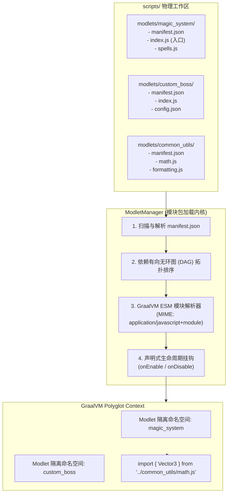

# 模块规范：标准 ESM 运行时与 Modlet 模块包体系 (ESM Modlet System)

在前代原型实现中，所有脚本均直接平铺存放在 `scripts/` 根目录下，通过对文件名按 `00_` 和字母顺序排序后直接在一个大全局域中编译求值。这种做法极易导致不同脚本之间的全局变量互相覆盖、依赖关系混乱，且完全无法使用现代 JavaScript 标准的 `import / export` 语法。

本模块规范确立 **标准 ECMAScript 模块 (ESM)** 原生支持，并建立一套轻量、模块化、带生命周期管理的 **Modlet 模块包规范**。

---

## 模块架构全景图



---

## Modlet 包结构与元数据规范

一个合规的 Modlet 是一个独立的文件夹，必须位于 `scripts/modlets/<modlet-id>/` 下，并具备如下标准目录结构：

```
scripts/modlets/magic_system/
├── manifest.json            // 必需：Modlet 元数据清单
├── index.js                 // 必需：主模块入口 (ESM 格式)
├── lib/                     // 可选：内部子模块
│   └── spell_effect.js
└── assets/                  // 可选：配套数据或配置
    └── spells.json
```

### 1. 元数据清单规范 (`manifest.json`)
```json
{
  "id": "magic_system",
  "name": "动态魔法系统",
  "version": "1.0.0",
  "description": "基于 Graal-Agent 的动态粒子魔法与法杖交互模组",
  "author": "GraalDev",
  "main": "index.js",
  "dependencies": {
    "common_utils": "^1.0.0"
  },
  "environment": "BOTH"
}
```

- `id`：唯一英文标识符，只能包含小写字母、数字与下划线；
- `main`：ESM 主入口文件，默认为 `index.js`；
- `dependencies`：所依赖的其他 Modlet 列表。加载器在启动时会自动进行**拓扑排序（Topological Sort）**，保证被依赖的前置包必定先于当前包加载；
- `environment`：运行环境限定，支持 `CLIENT`（仅客户端加载）、`SERVER`（仅独立服务端加载）、`BOTH`（双端通用）。

### 2. 标准 ESM 入口文件与生命周期规范 (`index.js`)

Modlet 必须采用标准 ECMAScript 语法编写，通过原生命名导出定义生命周期：

```javascript
// 支持从同包或跨包导入其他 ESM 模块
import { formatTitle } from './lib/spell_effect.js';
import { Vector3 } from '../common_utils/math.js';

/**
 * 模块启用钩子 (系统加载或热重载时触发)
 * @param {ModletContext} ctx 注入专属于当前 Modlet 的受限上下文门面
 */
export function onEnable(ctx) {
    ctx.logger.info("动态魔法系统正在启动...");

    // 注册指令
    ctx.commands.register("cast", (args, player) => {
        player.sendMessage(formatTitle("你释放了魔法！"));
    });

    // 注册定时任务 (热重载时框架会自动根据 Modlet 隔离清理，无需手动注销)
    ctx.timers.setInterval(() => {
        // 周期性粒子检查...
    }, 1000);

    // 监听事件
    ctx.events.on("key", (window, key) => {
        // 自定义按键监听
    });
}

/**
 * 模块禁用钩子 (热重载前夕或服务关闭时触发)
 */
export function onDisable() {
    // 执行自定义持久化保存或资源释放
}
```

---

## GraalVM 原生 ESM 解析器集成技术规范

在底层，通过调用 GraalVM 提供的 `application/javascript+module` MIME 类型，让引擎将源码作为独立 Module 解析：

```java
public Source createModuleSource(File file) throws IOException {
    return Source.newBuilder("js", file)
            .mimeType("application/javascript+module")
            .name(file.getName())
            .build();
}
```

### 自定义模块定位协议 (`FileSystem.resolve`)
为了使模块能够通过相对路径（如 `../common_utils/math.js`）精准定位依赖文件，加载器需实现定制的虚拟文件定位策略：
1. **相对路径解析**：基于引用方模块（Referrer）的真实物理路径进行规范化解析（`resolvePath`）；
2. **安全隔离**：严禁模块解析跳出 `scripts/` 工作目录边界；
3. **缓存与循环依赖检测**：GraalVM 内部基于 URL 缓存已加载的模块对象，配合 DAG 拓扑验证，杜绝循环依赖死锁。

---

## 增量热重载优势 (Incremental Reload)

对比旧架构中“修改一个文件必须关停所有 Context、全量重新加载所有脚本”的笨重设计，基于 ESM 的 Modlet 体系支持**单包增量重载**：
- 当用户仅修改了 `scripts/modlets/magic_system/spells.js` 时；
- `ModletManager` 仅调用该包的 `onDisable()`，注销其挂载的定时器和指令；
- 单独重新编译求值 `magic_system` 及其下游依赖包，其他无关 Modlet 毫秒不停歇继续运行！

---

## 相关文档双链

- [[Index]] - 返回技术蓝图索引
- [[System-Architecture]] - 查看系统分层拓扑
- [[Module-DualContext-Engine]] - 深入双容器运行环境
- [[Module-Concurrency-and-Events]] - 深入事件总线机制
- [[Module-Virtual-Datapack]] - 深入数据包资源集成
