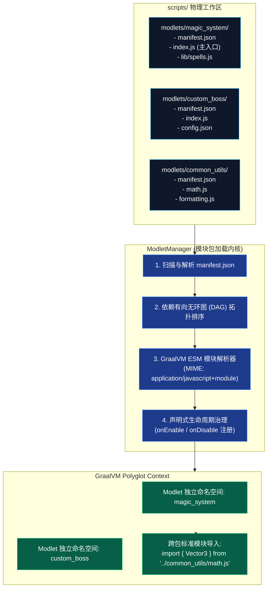

# 模块规范：标准 ESM 运行时与 Modlet 模块包体系 (ESM Modlet System)

在前代原型实现中，所有脚本均直接平铺存放在 `scripts/` 根目录下，通过对文件名按 `00_` 和字母顺序排序后直接在一个大全局域中编译求值。这种做法极易导致不同脚本之间的全局变量互相覆盖、依赖关系混乱，且完全无法使用现代 JavaScript 标准的 `import / export` 语法。

本模块规范确立 **标准 ECMAScript 模块 (ESM)** 原生支持，并建立一套轻量、模块化、带生命周期管理的 **Modlet 模块包规范**。

---

## 🏗️ 模块架构全景图



---

## ⚙️ 核心数据模板与 API 接口契约

### 1. 元数据清单模式规范与数据模型 (`manifest.json` & `ModletManifest`)

一个合规的 Modlet 是一个独立的自包含文件夹，位于 `scripts/modlets/<modlet-id>/` 下，标准结构如下：
- `scripts/modlets/<modlet-id>/`
  - `manifest.json`：**必需**。Modlet 核心元数据与依赖清单；
  - `index.js`：**必需**。Modlet 的 ECMAScript 主入口模块；
  - `lib/`：**可选**。内部子模块文件夹；
  - `assets/`：**可选**。配套的配置或静态资源文件。

#### `manifest.json` JSON 样例
```json
{
  "id": "magic_system",
  "name": "动态魔法系统",
  "version": "1.0.0",
  "description": "基于 Graal-Agent 的动态粒子魔法与法杖交互模组",
  "author": "GraalDev",
  "main": "index.js",
  "dependencies": {
    "common_utils": "^1.0.0"
  },
  "environment": "BOTH"
}
```

#### Java 不可变数据载体 (`ModletManifest`)
```java
package com.graalagent.modlet;

import java.nio.file.Path;
import java.util.Map;

/** Modlet 清单数据模型 */
public record ModletManifest(
        String id,
        String name,
        String version,
        String description,
        String author,
        String main,
        Map<String, String> dependencies,
        String environment
) {}

/** 运行时已加载的 Modlet 状态 */
public record ModletInfo(
        ModletManifest manifest,
        Path rootDir,
        boolean enabled
) {}
```

---

### 2. 标准 ESM 入口生命周期契约 (`index.js`)

Modlet 必须采用标准 ECMAScript 语法编写，通过导出特定的生命周期函数与框架进行协同：

```javascript
// index.js 标准入口模板
import { formatTitle } from '../common_utils/math.js';

/**
 * 模块启用钩子
 * @param {ModletContext} ctx 专属受控上下文门面
 */
export function onEnable(ctx) {
    ctx.logger.info("Magic System loaded: " + formatTitle("Spell Master"));

    // 注册指令 (当 Modlet 卸载时自动注销)
    ctx.commands.register("cast", (source, spellName) => {
        // 施法逻辑...
    });

    // 注册定时器 (模块热重载时自动清理)
    ctx.timers.setInterval(() => {
        // 定时粒子刷新
    }, 1000);
}

/**
 * 模块禁用钩子：在重载或停机前夕触发
 */
export function onDisable() {
    // 释放非托管资源或持久化状态
}
```

---

### 3. Modlet 管理器 API 契约 (`ModletManager`)

```java
package com.graalagent.modlet;

import java.nio.file.Path;
import java.util.List;

public class ModletManager {

    /** 扫描工作目录下所有 Modlet，构建 DAG 依赖图并按拓扑序装载 */
    public void scanAndLoadAll(Path modletsDir);

    /** 单包增量热重载：触发 onDisable -> 清理资源 -> 重新编译求值 -> 触发 onEnable */
    public void reloadModlet(String modletId);

    /** 禁用并卸载指定 Modlet */
    public void disableModlet(String modletId);

    /** 获取当前所有活动 Modlet 的快照 */
    public List<ModletInfo> getLoadedModlets();
}
```

---

## ⚡ 增量热重载架构 (Incremental Reload)

对比旧架构中“修改一个文件必须全量重启整个 JavaScript 运行时并重新执行所有脚本”的笨重机制，基于 ESM 的 Modlet 体系支持**单包增量重载**：
- 当用户仅修改了 `scripts/modlets/magic_system/spells.js` 时；
- `ModletManager` 仅调用 `magic_system` 的 `onDisable()`，清空其专属的定时器与命令节点；
- 仅重新编译求值 `magic_system` 及其直接依赖方，其余无关的 Modlet 毫秒不停歇继续运行，达成极速开发迭代体验。

---

## 🔗 相关导航
- 蓝图总索引：[[Index|新一代架构技术蓝图索引]]
- 核心术语：[[Terminology-and-Concepts|核心术语与物理概念体系]]
- 双容器引擎：[[Module-DualContext-Engine|双容器隔离引擎与看门狗抢占机制]]
- 并发与事件：[[Module-Concurrency-and-Events|异步事务缓冲与无锁事件总线]]
- 虚拟数据包：[[Module-Virtual-Datapack|虚拟内存数据包与动态资源管线]]
