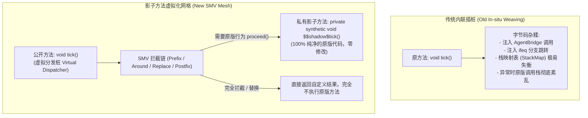
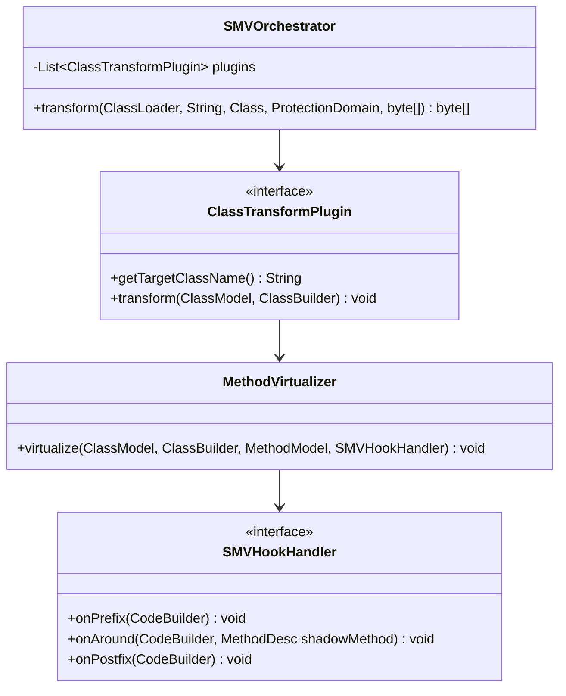

# 模块规范：影子方法虚拟化网格 (SMV Mesh)

本模块规范是整个新一代架构在底层插桩技术上的核心基石。它彻底颠覆了前代 [`MinecraftTransformer.java`](file:///H:/mc-mod/graal-agent/src/com/graalagent/transformer/MinecraftTransformer.java) 中直接在原方法体内硬编码汇编指令（`cb.invokestatic`, `cb.ifeq`, `cb.return_`）的传统内联插桩做法，正式确立了 **[[Shadow-Method-Virtualization|影子方法虚拟化 (Shadow Method Virtualization, 简称 SMV)]]** 工业标准。

---

## 为什么需要影子方法虚拟化 (SMV)？

### 1. 原版符号去混淆的历史契机
在 Minecraft 26+ 之前，官方方法名全为混淆字符（如 `m_123456_` 或 `a(b, c)`），字节码工具只能依赖庞大的映射表（Mappings）通过粗暴的插桩覆盖原指令。
自 Minecraft 26+ 起，符号混淆完全废除，原版语义直接保留（如 `tick()`, `runServer()`, `sendChat()`）。**这使得在字节码层面保留原版完整方法、构建清晰的面向对象式“影子转发”成为了可能。**

### 2. 传统内联插桩的死穴 vs SMV 的降维打击



- **零字节码破坏**：原版方法的所有操作码、局部变量表、异常表原封不动转移至私有方法 `$$shadow$<method>`，原版稳定性绝对不受影响。
- **天然支持环绕拦截 (Around) 与覆盖 (Replace)**：类似 Spring AOP 的 `ProceedingJoinPoint`，钩子可以决定是否调用 `proceed()`（即调用影子方法），亦可修改入参后再传给影子方法。
- **调试友好**：报错日志的堆栈清晰展示：`Minecraft.tick()` -> `SMVDispatcher` -> `$$shadow$tick()`，异常定位一目了然。

---

## SMV 虚拟转发网格架构设计



---

## JDK 22+ Class-File API 落地规范

利用 JDK 22+ 原生 `java.lang.classfile`，虚拟化一个方法的标准流程分为两步：**克隆生成影子方法** 与 **重写原方法为虚拟分发桩**。

### 1. 核心虚拟化器实现规范 (`MethodVirtualizer`)

```java
public class MethodVirtualizer {

    public static void virtualize(
            ClassBuilder classBuilder,
            MethodModel originalMethod,
            String shadowMethodName,
            Consumer<CodeBuilder> dispatcherLogic
    ) {
        // 1. 生成影子方法 (继承原方法的所有指令与签名，但置为 private synthetic)
        classBuilder.withMethod(
                shadowMethodName,
                originalMethod.methodType(),
                AccessFlag.PRIVATE.mask() | AccessFlag.SYNTHETIC.mask(),
                methodBuilder -> {
                    originalMethod.code().ifPresent(codeModel -> {
                        methodBuilder.withCode(codeBuilder -> {
                            codeModel.forEach(codeBuilder::with);
                        });
                    });
                }
        );

        // 2. 将原方法体替换为虚拟分发桩代码
        classBuilder.transformMethod(originalMethod, MethodTransform.transformingCode(
                (codeBuilder, element) -> {
                    // 清空原有代码，只写入 dispatcherLogic 构造的分发指令
                }
        ));
    }
}
```

### 2. 微内核插件责任链拆分规范

淘汰单一的巨石 `MinecraftTransformer`，在 `com.graalagent.transformer.plugins` 下拆分标准插件集：

| 插件类名 | 目标类 | 拦截方法 | SMV 拦截模式 | 业务意图 |
| :--- | :--- | :--- | :--- | :--- |
| `ClientTickPlugin` | `net.minecraft.client.Minecraft` | `tick()V` | Prefix + Around | 驱动客户端主心跳与事件派发 |
| `KeyboardHandlerPlugin` | `net.minecraft.client.KeyboardHandler` | `keyPress(...)V` | Around (按键阻断) | 支持 JS 回调按键并可消费取消原版响应 |
| `PacketListenerPlugin` | `ClientPacketListener` | `sendChat` / `sendCommand` | Around (包拦截) | 截获聊天指令，单人模式下直接在本地求值 |
| `ServerLifecyclePlugin` | `net.minecraft.server.MinecraftServer` | `runServer()V` | Prefix + Postfix | 捕获服务端启动就绪与安全终止 |
| `ServerTickPlugin` | `net.minecraft.server.MinecraftServer` | `tickServer(...)V` | Prefix | 驱动服务端主心跳与异步事务提交 |
| `CommandsInitPlugin` | `net.minecraft.commands.Commands` | `<init>(...)V` | Postfix | 注入服务端 Brigadier 命令总线 |
| `BundlerPlugin` | `net.minecraft.bundler.Main` | `run(...)V` | Replace (调用替换) | 修复类加载器父子委托链 |
| `PackRepositoryPlugin` | `PackRepository` | `<init>(...)V` | Replace (参数拦截) | 注入脚本合成数据包动态源 |

---

## 声明式插桩代码示例：`KeyboardHandlerPlugin`

通过 SMV 虚拟化按键拦截，代码逻辑极其优雅：

```java
public class KeyboardHandlerPlugin implements ClassTransformPlugin {
    @Override
    public String getTargetClassName() {
        return "net/minecraft/client/KeyboardHandler";
    }

    @Override
    public void transform(ClassModel cm, ClassBuilder cb) {
        for (MethodModel mm : cm.methods()) {
            if (mm.methodName().stringValue().equals("keyPress")
                    && mm.methodType().stringValue().equals("(JILnet/minecraft/client/input/KeyEvent;)V")) {

                MethodVirtualizer.virtualize(cb, mm, "$$shadow$keyPress", codeBuilder -> {
                    Label proceedLabel = codeBuilder.newLabel();
                    // 1. 调用 Agent 钩子 AgentBridge.onKey
                    codeBuilder.lload(1);
                    codeBuilder.iload(3);
                    codeBuilder.aload(4);
                    codeBuilder.invokestatic(
                            ClassDesc.of("com.graalagent.bridge.AgentBridge"),
                            "onKey",
                            MethodTypeDesc.ofDescriptor("(JILjava/lang/Object;)Z")
                    );
                    // 2. 若钩子返回 false (未消费)，调用影子方法 proceed()
                    codeBuilder.ifeq(proceedLabel);
                    codeBuilder.return_(); // 若已被 JS 消费，直接返回，取消原版按键响应！

                    // 3. 执行原版影子逻辑
                    codeBuilder.labelBinding(proceedLabel);
                    codeBuilder.aload(0); // this
                    codeBuilder.lload(1);
                    codeBuilder.iload(3);
                    codeBuilder.aload(4);
                    codeBuilder.invokespecial(
                            ClassDesc.of("net.minecraft.client.KeyboardHandler"),
                            "$$shadow$keyPress",
                            MethodTypeDesc.ofDescriptor("(JILnet/minecraft/client/input/KeyEvent;)V")
                    );
                    codeBuilder.return_();
                });
            }
        }
    }
}
```

---

## 相关文档双链

- [[Index]] - 返回技术蓝图索引
- [[System-Architecture]] - 查看系统分层拓扑
- [[Module-Bootstrap]] - Agent 引导加载
- [[Module-Bridge-and-Dispatcher]] - 桥接层分发网关
- [[Refactoring-and-Migration-Plan]] - 迁移重构实施规划
