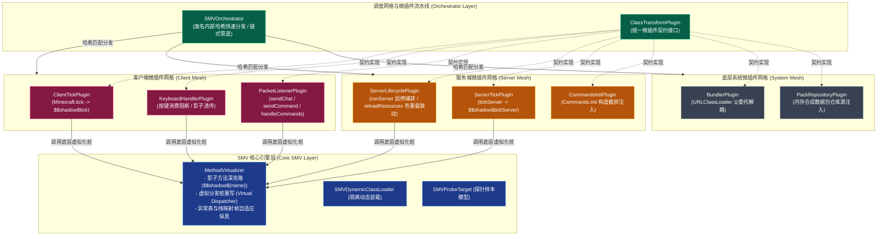
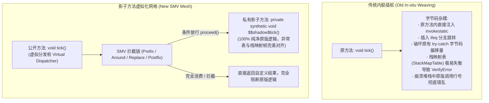
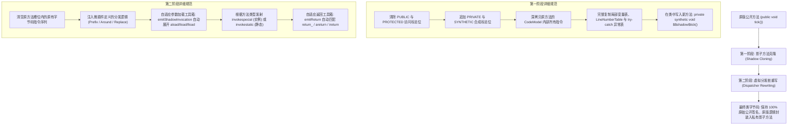

# 模块规范与实现：影子方法虚拟化网格 (SMV Bytecode Mesh)

本模块规范整合了早期字节码架构设计与 **Track 2 (`phase2_smv_bytecode_mesh_20261103`)** 所交付的全部核心实现。它彻底淘汰了原有的 402 行巨石单体类 `MinecraftTransformer.java`，全量落地了基于 **JDK 24+ Class-File API** 的 **[[Shadow-Method-Virtualization|影子方法虚拟化 (Shadow Method Virtualization, 简称 SMV)]]** 工业级网格流水线。

---

## 🧭 源码与测试工程导航

### 1. SMV 核心虚拟化引擎
- **核心虚拟化器**：[`src/com/graalagent/transformer/smv/MethodVirtualizer.java`](../../src/com/graalagent/transformer/smv/MethodVirtualizer.java)
- **动态隔离类加载器**：[`src/com/graalagent/transformer/smv/SMVDynamicClassLoader.java`](../../src/com/graalagent/transformer/smv/SMVDynamicClassLoader.java)
- **运行时字节码探针样本**：[`src/com/graalagent/transformer/smv/SMVProbeTarget.java`](../../src/com/graalagent/transformer/smv/SMVProbeTarget.java)
- **虚拟化核心单元测试**：[`test/com/graalagent/transformer/smv/MethodVirtualizerTest.java`](../../test/com/graalagent/transformer/smv/MethodVirtualizerTest.java)
- **ClassFile 实机验证脚本**：[`scripts/08_smv_method_virtualization_verify.js`](../../scripts/08_smv_method_virtualization_verify.js)

### 2. 网格调度器与微插件契约
- **微插件统一抽象契约**：[`src/com/graalagent/transformer/ClassTransformPlugin.java`](../../src/com/graalagent/transformer/ClassTransformPlugin.java)
- **中央流水线调度器**：[`src/com/graalagent/transformer/SMVOrchestrator.java`](../../src/com/graalagent/transformer/SMVOrchestrator.java)
- **网格调度器单元测试**：[`test/com/graalagent/transformer/SMVOrchestratorTest.java`](../../test/com/graalagent/transformer/SMVOrchestratorTest.java)
- **调度流水线实机验证脚本**：[`scripts/09_smv_orchestrator_verify.js`](../../scripts/09_smv_orchestrator_verify.js)

### 3. 客户端微插件集 (Client Mesh)
- **客户端主心跳微插件**：[`src/com/graalagent/transformer/plugins/ClientTickPlugin.java`](../../src/com/graalagent/transformer/plugins/ClientTickPlugin.java)
- **键盘按键阻断微插件**：[`src/com/graalagent/transformer/plugins/KeyboardHandlerPlugin.java`](../../src/com/graalagent/transformer/plugins/KeyboardHandlerPlugin.java)
- **网络数据包监听微插件**：[`src/com/graalagent/transformer/plugins/PacketListenerPlugin.java`](../../src/com/graalagent/transformer/plugins/PacketListenerPlugin.java)
- **客户端插件集单元测试**：[`test/com/graalagent/transformer/plugins/ClientPluginsTest.java`](../../test/com/graalagent/transformer/plugins/ClientPluginsTest.java)
- **客户端插件实机验证脚本**：[`scripts/10_client_plugins_verify.js`](../../scripts/10_client_plugins_verify.js)

### 4. 服务端与底层系统微插件集 (Server & System Mesh)
- **服务端生命周期微插件**：[`src/com/graalagent/transformer/plugins/ServerLifecyclePlugin.java`](../../src/com/graalagent/transformer/plugins/ServerLifecyclePlugin.java)
- **服务端主心跳微插件**：[`src/com/graalagent/transformer/plugins/ServerTickPlugin.java`](../../src/com/graalagent/transformer/plugins/ServerTickPlugin.java)
- **指令总线构造注入微插件**：[`src/com/graalagent/transformer/plugins/CommandsInitPlugin.java`](../../src/com/graalagent/transformer/plugins/CommandsInitPlugin.java)
- **Bundler 类加载解耦微插件**：[`src/com/graalagent/transformer/plugins/BundlerPlugin.java`](../../src/com/graalagent/transformer/plugins/BundlerPlugin.java)
- **合成数据包仓库源微插件**：[`src/com/graalagent/transformer/plugins/PackRepositoryPlugin.java`](../../src/com/graalagent/transformer/plugins/PackRepositoryPlugin.java)
- **服务端与系统插件单元测试**：[`test/com/graalagent/transformer/plugins/ServerAndSystemPluginsTest.java`](../../test/com/graalagent/transformer/plugins/ServerAndSystemPluginsTest.java)
- **服务端与系统插件验证脚本**：[`scripts/11_server_plugins_verify.js`](../../scripts/11_server_plugins_verify.js)

---

## 🏗️ SMV 网格全景架构拓扑



---

## 💡 为什么必须采用影子方法虚拟化 (SMV)？

### 1. 现代化去混淆环境的历史契机
在 Minecraft 26+ 之前，官方方法名全为混淆字符（如 `m_123456_` 或 `a(b, c)`），字节码修改依赖脆弱的映射表（Mappings）通过粗暴的插桩覆盖原指令。
> [!NOTE] 现代化符号环境与 SMV 契机
> Minecraft 26+ 以上版本官方发布时已不再发布映射也不混淆符号。可以用标准的工具进行读取。
> **代码中符号混淆消失之后，本项目才得以 [[Shadow-Method-Virtualization|影子方法虚拟化]] 注入！**
> 在所有类与方法名称固定公开的前提下，原版语义直接保留（如 `tick()`、`runServer()`、`sendChat()`），这使得在字节码层面保留原版完整方法、构建清晰的面向对象式“影子转发”成为了现实。

### 2. 传统内联插桩的死穴 vs SMV 的降维打击



- **零字节码破坏**：原版方法的所有操作码、局部变量表、异常表原封不动迁移至私有合成方法 `$$shadow$<method>`，原版稳定性绝对不受波及；
- **天然支持环绕拦截 (Around) 与覆盖 (Replace)**：类似 Spring AOP 的 `ProceedingJoinPoint`，钩子可以根据前置逻辑执行结果决定是否放行调用影子方法（如按键已被 JS 脚本消费时直接返回，取消原版响应）；
- **HotSpot JIT C2 完美内联**：私有合成方法调用（`invokespecial`）与静态方法调用属于直接调用，可被 JVM C2 编译器无缝内联，实现零运行时额外开销；
- **异常排查高度友好**：崩溃堆栈清晰展现调用链路（`tick()` $\to$ `SMVDispatcher` $\to$ `$$shadow$tick()`），行号与堆栈层级一目了然。

---

## ⚙️ 核心虚拟化算法与两阶段模型 (Two-Phase Virtualization)

[`MethodVirtualizer`](../../src/com/graalagent/transformer/smv/MethodVirtualizer.java) 基于 JDK 24+ 原生 `java.lang.classfile` 构建，将目标方法虚拟化分为两阶段：



### 1. 核心工具箱与指令自适应发射
- **`emitShadowInvocation`**：自动根据目标方法的 `MethodTypeDesc` 分析每一个参数的类型与插槽跨度（针对 `long` / `double` 占用 2 个局部变量槽进行精确偏移计算），并将 `this` 指针与全部入参推入操作数栈后发射调用；
- **`emitReturn`**：自适应匹配对应返回类型的专用操作码（`return_`, `areturn`, `ireturn`, `lreturn` 等）；
- **`createPrefixDispatcher`**：工厂方法，一键生成前置执行分发桩；
- **`createForwardDispatcher`**：工厂方法，一键生成纯净直通转发桩。

### 2. 异常表（Exception Table）与栈映射安全保真
针对包含复杂 `try-catch` 块的方法（如在 [`SMVProbeTarget.java`](../../src/com/graalagent/transformer/smv/SMVProbeTarget.java) 中测试的方法）：
在克隆生成影子方法时，深拷贝保留了完整的 `ExceptionCatch` 指令元素序列。原方法的异常捕获范围、处理器跳转入口与异常类引用在影子方法内部实现 **100% 字节对齐**；分发桩本身采用平坦线性控制流，彻底消除了旧架构因指令偏移变动导致 JVM 校验器抛出 `VerifyError` 的风险。

---

## 🧩 网格调度器与微插件流水线 (`SMVOrchestrator`)

### 1. 微插件契约 (`ClassTransformPlugin`)
所有微插件均实现 [`ClassTransformPlugin`](../../src/com/graalagent/transformer/ClassTransformPlugin.java) 契约接口：
- `getTargetClassName()`：声明目标类的 JVM 内部名称（如 `net/minecraft/client/Minecraft`）；
- `transform(ClassModel cm, ClassBuilder cb)`：针对目标类执行精确的方法虚拟化与指令组装。

### 2. 调度器核心特性 (`SMVOrchestrator`)
- **$O(1)$ 哈希快速路由**：调度器使用线程安全的哈希表维护目标类名与插件集合的映射。类加载时直接命中对应插件列表，未命中类在 $< 10\text{ ns}$ 内返回 `null`，实现原字节码零拷贝透传；
- **运行时内部类安全豁免**：强制豁免 `java/`、`jdk/`、`sun/`、`com/oracle/`、`org/graalvm/` 与 `com/graalagent/` 命名空间，防止类变换过程递归触发 JVM 内部类加载导致 `StackOverflowError` 或引导死锁；
- **链式微插件流水线 (Chained Pipeline)**：当同一个类注册了多个独立微插件时，调度器按顺序将前一个插件输出的 byte 数组递交给下一个插件连续加工；
- **JS 动态转换器桥接**：内置微插件处理完成后，字节码自动投递给 `ScriptManager` 供用户 JavaScript 脚本进行二次动态转换。

---

## ⚙️ 核心 API 接口契约与插件数据模板

### 1. 微插件统一契约接口 (`ClassTransformPlugin`)

每个标准微插件通过实现 [`ClassTransformPlugin`](../../src/com/graalagent/transformer/ClassTransformPlugin.java) 接口，独立声明其关注的目标类并执行变换：

```java
package com.graalagent.transformer;

import java.lang.classfile.ClassBuilder;
import java.lang.classfile.ClassModel;
import java.lang.classfile.ClassTransform;

/**
 * 统一微插件契约接口。
 * 每个标准微插件负责单个 Minecraft 类的字节码影子虚拟化与指令拦截。
 */
public interface ClassTransformPlugin {

    /**
     * 获取目标类的 JVM 内部名称（例如 "net/minecraft/client/Minecraft"）
     */
    String getTargetClassName();

    /**
     * 针对目标类执行影子方法虚拟化或指令注入。
     * SMVOrchestrator 会自动透传未被插件修改的其余类元素。
     */
    void transform(ClassModel classModel, ClassBuilder classBuilder);

    /**
     * 可选：需要全量控制 ClassTransform 流水线时重写
     */
    default ClassTransform asClassTransform(ClassModel classModel) {
        return null;
    }
}
```

---

### 2. SMV 核心虚拟化器 API 契约 (`MethodVirtualizer`)

[`MethodVirtualizer`](../../src/com/graalagent/transformer/smv/MethodVirtualizer.java) 提供两阶段方法虚拟化与分发桩自适应组装工具箱：

```java
package com.graalagent.transformer.smv;

import java.lang.classfile.ClassBuilder;
import java.lang.classfile.CodeBuilder;
import java.lang.classfile.MethodModel;
import java.lang.constant.ClassDesc;
import java.lang.constant.MethodTypeDesc;
import java.util.function.Consumer;

public final class MethodVirtualizer {

    /** 生成标准命名的私有合成影子方法名: $$shadow$<name> */
    public static String shadowName(String originalMethodName);

    /**
     * 核心虚拟化方法：将目标方法克隆为影子方法，并将原方法槽位替换为自定义分发逻辑
     */
    public static void virtualize(
            ClassBuilder classBuilder,
            MethodModel originalMethod,
            String shadowMethodName,
            Consumer<CodeBuilder> dispatcherLogic
    );

    /**
     * 自适应参数加载与影子调用发射器：自动分析入参插槽偏移并展开 aload/iload/lload
     */
    public static void emitShadowInvocation(
            CodeBuilder cb,
            ClassDesc ownerClass,
            String shadowMethodName,
            MethodTypeDesc methodType,
            boolean isStatic
    );

    /** 自适应返回指令发射器 (根据返回值类型发射 return_ / areturn / ireturn / lreturn) */
    public static void emitReturn(CodeBuilder cb, MethodTypeDesc methodType);

    /** 工厂方法：生成前置执行 (Prefix) 分发桩 */
    public static Consumer<CodeBuilder> createPrefixDispatcher(
            ClassDesc ownerClass,
            String shadowMethodName,
            MethodTypeDesc methodType,
            Consumer<CodeBuilder> prefixHook
    );

    /** 工厂方法：生成直通无条件转发分发桩 */
    public static Consumer<CodeBuilder> createForwardDispatcher(
            ClassDesc ownerClass,
            String shadowMethodName,
            MethodTypeDesc methodType
    );
}
```

---

### 3. 网格调度器 API 契约 (`SMVOrchestrator`)

[`SMVOrchestrator`](../../src/com/graalagent/transformer/SMVOrchestrator.java) 作为中央类文件转换器实现：

```java
package com.graalagent.transformer;

import java.lang.instrument.ClassFileTransformer;
import java.security.ProtectionDomain;

public class SMVOrchestrator implements ClassFileTransformer {

    /** 工厂方法：创建并装配全套 8 大核心微插件流水线 */
    public static SMVOrchestrator createDefault();

    /** 注册自定义微插件 */
    public void registerPlugin(ClassTransformPlugin plugin);

    /** 标准 ClassFileTransformer 转换入口 ($O(1)$ 哈希快速分发与链式管道) */
    @Override
    public byte[] transform(
            ClassLoader loader,
            String className,
            Class<?> classBeingRedefined,
            ProtectionDomain protectionDomain,
            byte[] classfileBuffer
    );
}
```

---

### 4. 标准微插件实现范式 (`KeyboardHandlerPlugin`)

遵循 **JDK 24+ Nominal Typing First** 标准编写的按键阻断微插件：

```java
package com.graalagent.transformer.plugins;

import com.graalagent.bridge.AgentBridge;
import com.graalagent.transformer.ClassTransformPlugin;
import com.graalagent.transformer.smv.MethodVirtualizer;
import java.lang.classfile.*;
import java.lang.constant.ClassDesc;
import java.lang.constant.ConstantDescs;
import java.lang.constant.MethodTypeDesc;

public class KeyboardHandlerPlugin implements ClassTransformPlugin {
    public static final String TARGET_CLASS = "net/minecraft/client/KeyboardHandler";

    private static final ClassDesc CD_KEYBOARD = ClassDesc.of("net.minecraft.client.KeyboardHandler");
    private static final ClassDesc CD_BRIDGE = ClassDesc.of("com.graalagent.bridge.AgentBridge");
    private static final ClassDesc CD_KEY_EVENT = ClassDesc.of("net.minecraft.client.input.KeyEvent");

    private static final MethodTypeDesc MTD_KEY_PRESS = MethodTypeDesc.of(
            ConstantDescs.CD_void, ConstantDescs.CD_long, ConstantDescs.CD_int, CD_KEY_EVENT);
    private static final MethodTypeDesc MTD_ON_KEY = MethodTypeDesc.of(
            ConstantDescs.CD_boolean, ConstantDescs.CD_long, ConstantDescs.CD_int, ConstantDescs.CD_Object);

    @Override
    public String getTargetClassName() {
        return TARGET_CLASS;
    }

    @Override
    public void transform(ClassModel classModel, ClassBuilder classBuilder) {
        for (MethodModel mm : classModel.methods()) {
            if (mm.methodName().equalsString("keyPress") && mm.methodTypeSymbol().equals(MTD_KEY_PRESS)) {
                MethodVirtualizer.virtualize(classBuilder, mm, "$$shadow$keyPress", cb -> {
                    Label proceedLabel = cb.newLabel();
                    // 1. 调用 Agent 钩子 AgentBridge.onKey(window, key, event)
                    cb.lload(1);
                    cb.iload(3);
                    cb.aload(4);
                    cb.invokestatic(CD_BRIDGE, "onKey", MTD_ON_KEY);

                    // 2. 若钩子返回 false (未消费)，放行调用影子方法
                    cb.ifeq(proceedLabel);
                    cb.return_(); // 按键已被消费，阻断原版响应！

                    // 3. 执行原版影子方法
                    cb.labelBinding(proceedLabel);
                    MethodVirtualizer.emitShadowInvocation(cb, CD_KEYBOARD, "$$shadow$keyPress", MTD_KEY_PRESS, false);
                    cb.return_();
                });
            }
        }
    }
}
```

---
## 📦 八大核心微插件落地清单

| 插件类名 | 目标类与完整包路径 | 拦截目标方法语义签名 | 插桩模式与机制 | 核心业务职责与技术要点 |
| :--- | :--- | :--- | :--- | :--- |
| **`ClientTickPlugin`** | `net.minecraft.client.Minecraft` | `void tick()` | **SMV 虚拟化**<br>(Prefix + Around) | 客户端帧心跳前置广播 `AgentBridge.onTick()`，驱动客户端事件总线与定时器 |
| **`KeyboardHandlerPlugin`** | `net.minecraft.client.KeyboardHandler` | `void keyPress(long, int, KeyEvent)` | **SMV 虚拟化**<br>(Around 消费阻断) | 捕获按键并投递 `AgentBridge.onKey`。若脚本返回 true 消费按键，条件分支直接返回，阻断原版按键响应 |
| **`PacketListenerPlugin`** | `net.minecraft.client.multiplayer.ClientPacketListener` | `void sendChat(String)`<br>`void sendCommand(String)`<br>`void handleCommands(...)` | **SMV 虚拟化**<br>(Around + Postfix) | 截获聊天消息与客户端发出的指令；在接收服务端指令树时提取 `commands` 字段并注入补全树 |
| **`ServerLifecyclePlugin`** | `net.minecraft.server.MinecraftServer` | `void runServer()`<br>`CompletableFuture reloadResources(...)` | **SMV 虚拟化**<br>(Prefix + Postfix) | 捕获服务端启动上下文与停止释放；包装重载返回的 `CompletableFuture` 联动 JS 脚本自动热重载 |
| **`ServerTickPlugin`** | `net.minecraft.server.MinecraftServer` | `void tickServer(BooleanSupplier)` | **SMV 虚拟化**<br>(Prefix) | 驱动服务端每 50ms 一次的主心跳，刷新主线程事务缓冲队列与事件派发 |
| **`CommandsInitPlugin`** | `net.minecraft.commands.Commands` | `<init>(CommandSelection, CommandBuildContext)` | **AST 指令注入**<br>(Return Hook) | 在命令管理类构造完成即将返回前拦截，提取 `CommandDispatcher` 并挂载服务端 Brigadier 指令网关 |
| **`BundlerPlugin`** | `net.minecraft.bundler.Main` | `void run(String[])` | **AST 指令切除**<br>(Instruction Omission) | 剔除 `ClassLoader.getParent()` 截断调用，恢复系统类加载器委托链，确保 Agent 类全局可见 |
| **`PackRepositoryPlugin`** | `net.minecraft.server.packs.repository.PackRepository` | `<init>(RepositorySource...)` | **AST 指令包装**<br>(Invoke Interception) | 拦截仓库源数组参数，通过 `DatapackManager.injectSources` 动态合并虚拟合成数据包目录源 |

---

## 🗑️ 旧版巨石单体类的废弃与移除

在 Phase 2 重构验收阶段（commit `b4934c2`），原有的旧版单体类 `MinecraftTransformer.java`（已于 commit `b4934c2` 彻底废弃删除，-402 lines）：
- 消除原有冗长脆弱的 `if-else` 级联；
- 消除直接向原方法拼接底层汇编指令的隐患；
- 系统引导入口 [`AgentMain.java`](../../src/com/graalagent/AgentMain.java) 全面换装为 `SMVOrchestrator.createDefault()`。

---

## 🧪 单元测试与实机验证

本模块拥有立体的测试资产保障（详见 [[Verification-and-Testing|验证与基准测试套件体系]]）：
1. **Java 离线断言**：[`MethodVirtualizerTest.java`](../../test/com/graalagent/transformer/smv/MethodVirtualizerTest.java)、[`SMVOrchestratorTest.java`](../../test/com/graalagent/transformer/SMVOrchestratorTest.java)、[`ClientPluginsTest.java`](../../test/com/graalagent/transformer/plugins/ClientPluginsTest.java)、[`ServerAndSystemPluginsTest.java`](../../test/com/graalagent/transformer/plugins/ServerAndSystemPluginsTest.java)；
2. **GraalJS 实机脚本模拟**：[`scripts/08_smv_method_virtualization_verify.js`](../../scripts/08_smv_method_virtualization_verify.js)、[`scripts/09_smv_orchestrator_verify.js`](../../scripts/09_smv_orchestrator_verify.js)、[`scripts/10_client_plugins_verify.js`](../../scripts/10_client_plugins_verify.js)、[`scripts/11_server_plugins_verify.js`](../../scripts/11_server_plugins_verify.js)；
3. **自动化执行**：通过 [`verify-smv.ps1`](../../verify-smv.ps1) 一键调度执行。

---

## 🔗 相关导航
- 蓝图总索引：[[Index|新一代架构技术蓝图索引]]
- 核心术语：[[Terminology-and-Concepts|核心术语与物理概念体系]]
- 引导装载：[[Module-Bootstrap|引导装载与类加载脱壳]]
- 跨端网关：[[Module-Bridge-and-Dispatcher|跨端桥接与统一指令网关]]
- 测试矩阵：[[Verification-and-Testing|验证与基准测试套件体系]]
