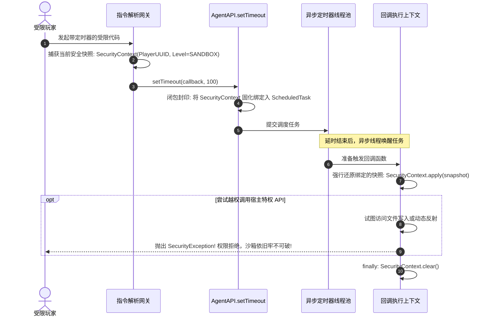

# 模块规范：闭包安全令牌与零信任沙箱规范 (Security Specification)

本模块规范基于对前代沙箱机制中致命的“异步定时器沙箱逃逸”与“`HostAccess.ALL` 反射越权隐患”的深入剖析，确立一套**基于闭包不可变安全令牌（SecurityContext Token）**与**零信任显式白名单（Zero-Trust HostAccess）**的工业级安全规范。

---

## 🛡️ 终结“异步定时器逃逸”的数学级防线

### 1. 致命漏洞机理复盘
在前代实现中，安全判断依托于当前工作线程的 `ThreadLocal<Boolean>`：
1. 玩家在游戏内发起带延时的异步脚本调用（如通过 `setTimeout` 注册回调）；
2. 主命令线程在进入 `setTimeout` 注册时处于受限状态，但在命令返回后立即清理了线程局部标记；
3. 延时结束后，定时任务在独立的异步定时器线程中被唤醒。**由于该异步线程从未被标记为沙箱态，其权限标志为默认的非沙箱状态！**
4. **灾难性后果**：定时器回调内部获得了与服务端控制台等同的最高管理员权限，恶意玩家可以利用该回调肆意读写服务器任何私密文件甚至执行宿主系统命令。

### 2. 解决方案：不可变闭包安全令牌 (`SecurityContext`)
新架构规范确立：**禁止仅依赖隐式线程局部变量判断权限，所有异步任务提交时必须对发起者的安全身份实施物理快照绑定！**



---

## ⚙️ 核心数据模板与 API 接口契约

### 1. 安全权限等级与不可变安全上下文数据模板 (`SecurityContext`)

```java
package com.graalagent.security;

import java.util.UUID;

/** 权限级别枚举 */
public enum PermissionLevel {
    CONSOLE(4),        // 物理服务端控制台，拥有绝对不受限特权
    ADMIN(2),          // 游戏内 OP / 管理员
    PLAYER_SANDBOX(0); // 普通玩家受限沙箱

    private final int level;
    PermissionLevel(int level) { this.level = level; }
    public int getLevel() { return level; }
    public boolean isAtLeast(PermissionLevel other) { return this.level >= other.level; }
}

/** 不可变安全上下文快照模型 */
public record SecurityContext(
        UUID subjectUUID,
        String subjectName,
        PermissionLevel permissionLevel,
        long creationTimestamp,
        boolean isConsole
) {
    public static SecurityContext console() {
        return new SecurityContext(new UUID(0, 0), "CONSOLE", PermissionLevel.CONSOLE, System.currentTimeMillis(), true);
    }
}
```

---

### 2. 安全令牌管理器 API 契约 (`SecurityContextManager`)

```java
package com.graalagent.security;

import java.util.concurrent.Callable;

public final class SecurityContextManager {

    /** 获取当前线程上下文绑定的安全快照 (未设值时默认降级为 PLAYER_SANDBOX) */
    public static SecurityContext current();

    /** 将安全快照设入当前线程 */
    public static void set(SecurityContext context);

    /** 清除当前线程绑定的安全快照 */
    public static void clear();

    /**
     * 闭包不可伪造包装器：将快照固化并绑定至 Runnable 任务中
     */
    public static Runnable wrap(Runnable task, SecurityContext snapshot);

    /**
     * 闭包不可伪造包装器：将快照固化并绑定至 Callable 任务中
     */
    public static <T> Callable<T> wrap(Callable<T> task, SecurityContext snapshot);

    /** 权限断言门禁：若当前权限不足，立即抛出 SecurityException 阻断操作 */
    public static void assertPermission(PermissionLevel requiredLevel) {
        if (!current().permissionLevel().isAtLeast(requiredLevel)) {
            throw new SecurityException("Permission denied. Required: " + requiredLevel + ", Found: " + current().permissionLevel());
        }
    }
}
```

---

## 🔒 零信任宿主访问规范 (Zero-Trust HostAccess)

前代代码采用了危险的 `HostAccess.ALL`，意味着脚本一旦拿到任何 Java 对象的指针，理论上均可调用其所有公开方法（包括 `getClass()`、`wait()` 等）。

新架构规范全面推行 **分级零信任访问策略**：

### 1. 玩家沙箱：`HostAccess.NONE` + 受控领域 DTO 代理
针对游戏内玩家执行的脚本：
- **完全关闭 Java 原生对象直接暴露**：配置 `HostAccess.NONE`，禁止任何未经包装的 Java 原生对象落入 JS 环境；
- **只暴露受控 Proxy**：仅向沙箱注入受控的领域对象代理（如 `PlayerProxy`、`WorldProxy`），代理内部仅暴露经过严格安全审计的只读业务方法（如发送消息、读取坐标），从根本上切断一切基于 Java 反射的探测（如 `Java.type`、`obj.getClass().forName(...)`）。

### 2. 系统环境：`HostAccess.EXPLICIT`
针对特权系统上下文（System Context）：
- 仅允许访问显式标注了 `@HostAccess.Export` 的 API 方法；
- 严禁向脚本暴露任何能够获取 `ClassLoader`、`Field` 或动态生成类的高危句柄。

---

## 🧊 原型链深冻结规范 (Prototype Tampering Defense)

在 ECMAScript 中，攻击者常利用“原型链污染”（Prototype Pollution）修改基础对象（例如篡改 `Array.prototype.push` 或 `Object.prototype.toString`），破坏全局基础行为。

新架构规范规定：**在每个沙箱容器初始化就绪后，必须立即执行原生原型链深度递归冻结！**
- 遍历全局基础类型目标：`Object`、`Array`、`Function`、`String`、`Number`、`Boolean`、`Promise`、`Map`、`Set`；
- 对每个目标及其 `prototype` 属性递归调用 `Object.freeze`；
- 彻底阻断任何对宿主全局环境的基础原型篡改。

---

## 📋 统一安全审计日志 (Security Telemetry)

任何触发权限违规的操作，系统必须由 [[Module-Diagnostics-and-Logging|遥测中心]] 记录包含高维度上下文的结构化安全审计日志：
- 违规事件：`UNAUTHORIZED_HOST_ACCESS` / `TIMEOUT_PREEMPTION` / `PROTOTYPE_POLLUTION_ATTEMPT`；
- 违规主体：主体 UUID、玩家名、来源渠道；
- 现场快照：触发时刻正在执行的代码片段、行号与完整因果链调用栈。

---

## 🔗 相关导航
- 蓝图总索引：[[Index|新一代架构技术蓝图索引]]
- 核心术语：[[Terminology-and-Concepts|核心术语与物理概念体系]]
- 双容器引擎：[[Module-DualContext-Engine|双容器隔离引擎与看门狗抢占机制]]
- 遥测引擎：[[Module-Diagnostics-and-Logging|结构化遥测与多维日志诊断]]
- 验证套件：[[Verification-and-Testing|验证与基准测试套件体系]]
