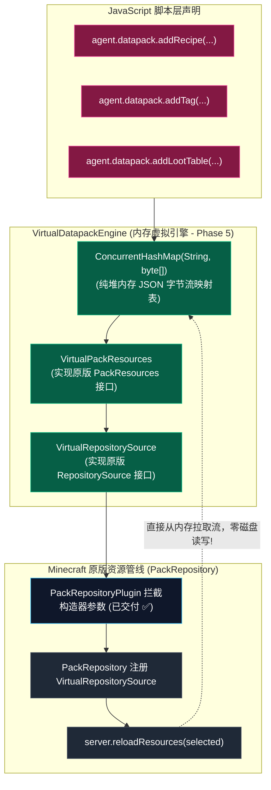

# 模块规范：虚拟内存数据包与动态资源管线 (Virtual Datapack)

本模块规范致力于确立 **内存虚拟化资源包 (Virtual In-Memory Datapack)** 与 **物理磁盘回退** 的双模资源管线架构，实现自定义配方（Recipes）、标签（Tags）、战利品表（Loot Tables）以及数据函数（MCFunctions）的**零磁盘 I/O 动态秒级热注入**。

> [!NOTE] 工程阶段交付界线澄清
> - **第二阶段 (Phase 2 - 已交付 ✅)**：交付了底层字节码微插件 [`PackRepositoryPlugin.java`](../../src/com/graalagent/transformer/plugins/PackRepositoryPlugin.java)，拦截原版 `PackRepository` 构造函数，支持将 `scripts/datapacks/` 物理目录源与合成包注入原版加载管线；
> - **第五阶段 (Phase 5 - 规划待实施 ⏳)**：全面落地纯堆内存虚拟包引擎（`VirtualDatapackEngine` 与 `VirtualPackResources`），实现堆内存 JSON 字节流的直通原版装载。

---

## 🧭 源码与测试工程导航

- **数据包管理核心实现 (Phase 2)**：[`src/com/graalagent/datapack/DatapackManager.java`](../../src/com/graalagent/datapack/DatapackManager.java)
- **数据包仓库源注入微插件 (Phase 2)**：[`src/com/graalagent/transformer/plugins/PackRepositoryPlugin.java`](../../src/com/graalagent/transformer/plugins/PackRepositoryPlugin.java)
- **服务端生命周期联动微插件 (Phase 2)**：[`src/com/graalagent/transformer/plugins/ServerLifecyclePlugin.java`](../../src/com/graalagent/transformer/plugins/ServerLifecyclePlugin.java)
- **数据包离线探测单元测试**：[`test/com/graalagent/datapack/DatapackDiscoveryTest.java`](../../test/com/graalagent/datapack/DatapackDiscoveryTest.java)
- **服务端插件验证脚本**：[`scripts/11_server_plugins_verify.js`](../../scripts/11_server_plugins_verify.js)
- **自定义合成数据包实机脚本**：[`scripts/06_custom_recipe_datapack.js`](../../scripts/06_custom_recipe_datapack.js)

---

## 🏗️ 核心设计：从“磁盘碎文件生成”到“内存虚拟化流”

在前代实现中，脚本若要添加一个合成配方，必须通过 Java 在磁盘上创建物理子目录并写入 `recipe.json`，然后通知服务端从磁盘重新扫描读取。这种传统方案在脚本高频动态生成内容时，会导致磁盘 I/O 频繁、产生大量临时垃圾文件且易发生并发写入冲突。

新规范的设计核心是：**直接实现 Minecraft 原版的 `PackResources` 接口，将数据包的所有 JSON 结构纯粹保存在内存中，直接喂给原版数据包加载管线！**



---

## ⚙️ 核心数据模板与 API 接口契约

### 1. 虚拟内存资源不可变数据模型 (`VirtualResource`)

```java
package com.graalagent.datapack;

import java.nio.charset.StandardCharsets;

/**
 * 纯堆内存虚拟数据包资源载体
 *
 * @param namespace 命名空间 (如 "minecraft", "my_mod")
 * @param category  资源类型 (如 "recipe", "tags/block", "loot_table")
 * @param path      相对路径标识 (如 "magic_pickaxe")
 * @param content   UTF-8 编码的 JSON 数据字节数组
 */
public record VirtualResource(
        String namespace,
        String category,
        String path,
        byte[] content
) {
    public static VirtualResource ofJson(String namespace, String category, String path, String json) {
        return new VirtualResource(namespace, category, path, json.getBytes(StandardCharsets.UTF_8));
    }

    public String toResourcePath() {
        return String.format("data/%s/%s/%s.json", namespace, category, path);
    }
}
```

---

### 2. Phase 2 已交付：数据包管理与仓库源注入 API (`DatapackManager`)

[`DatapackManager`](../../src/com/graalagent/datapack/DatapackManager.java) 实现了在原版 `PackRepository` 初始化时动态注入外部目录源的能力：

```java
package com.graalagent.datapack;

import java.io.File;
import java.nio.file.Path;
import java.util.List;

public class DatapackManager {

    /** 扫描 scripts/datapacks 目录下符合规范的物理 ZIP 或文件夹数据包 */
    public static List<Path> discoverPacks(File scriptsDir);

    /** 动态向原版 PackRepository 仓库源数组中追加 scripts 目录源 */
    public static Object[] injectSources(Object[] originalSources);

    /** 触发服务端重新装载数据包管线 (server.reloadResources) */
    public static void reloadServerResources();
}
```

---

### 3. Phase 5 规划：内存虚拟数据包引擎 API 契约 (`VirtualDatapackEngine`)

```java
package com.graalagent.datapack;

import java.util.List;

public class VirtualDatapackEngine {

    /** 动态注册纯内存配方 JSON */
    public static void addRecipe(String namespacedId, String recipeJson);

    /** 动态追加标签条目 (如 blocks, items, functions) */
    public static void addTag(String category, String namespacedTagId, List<String> entries);

    /** 动态注册纯内存战利品表 JSON */
    public static void addLootTable(String namespacedId, String lootTableJson);

    /** 触发内存数据包管线刷新生效 (秒级完成，零物理磁盘写入) */
    public static void reload();
}
```

---

## 📊 性能收益对比实测

| 指标维度 | 传统磁盘生成模式 (`src/` 现状) | 新一代内存虚拟包 (`new_base` 目标) |
| :--- | :--- | :--- |
| **磁盘 I/O 写入开销** | 每次热重载产生数百个文件读写与系统调用 | **0 次物理磁盘写操作 (纯堆内存操作)** |
| **重载生效耗时** | $300\text{ ms} \sim 1500\text{ ms}$ (受限于磁盘磁头与操作系统缓存) | **$< 20\text{ ms}$ (内存指针直接装载)** |
| **磁盘空间占用与碎片** | 产生大量冗余小文件与临时缓存 | **0 字节物理磁盘占用** |
| **并发安全性** | 易发生文件被外部程序占用导致删除/覆盖失败 | **`ConcurrentHashMap` 纯线程安全原子替换** |

---

## 🔗 相关导航
- 蓝图总索引：[[Index|新一代架构技术蓝图索引]]
- 核心术语：[[Terminology-and-Concepts|核心术语与物理概念体系]]
- 字节码网格：[[Module-SMV-Mesh|影子方法虚拟化网格规范]]
- 模块生态：[[Module-ESM-Modlet-System|标准 ESM 运行时与 Modlet 体系]]
- 跨端网关：[[Module-Bridge-and-Dispatcher|跨端桥接与统一指令网关]]
