# 演进路线：平滑重构与迁移落地实施计划 (Refactoring and Migration Plan)

本实施计划旨在为项目团队提供从前代遗留单体代码平滑升级至 `docs/new_base/` 终极生产级架构的清晰实施路径。规划遵循**渐进式演进（Incremental Evolution）**与**零停机验证**原则，共划分为六个严密的工程阶段。

截至当前，**第一阶段（基础设施）**与**第二阶段（SMV 字节码网格）**已全量实施并通过双层立体验证，正式交付生产！

---

## 阶段演进总览流水线

```mermaid
flowchart LR
    classDef done fill:#065f46,stroke:#10b981,color:#fff
    classDef planned fill:#1f2937,stroke:#4b5563,color:#fff

    subgraph Phase1["第一阶段: 基础设施重构 (已交付 ✅)"]
        P1["- MethodHandleCache\n- BrigadierAdapter\n- DiagnosticsHub\n- AgentConfig"]:::done
    end

    subgraph Phase2["第二阶段: 字节码引擎革命 (已交付 ✅)"]
        P2["- MethodVirtualizer (SMV)\n- 8 大微插件流水线\n- 废弃移除巨石单体\n- verify-smv.ps1 验证总线"]:::done
    end

    subgraph Phase3["第三阶段: 核心并发与看门狗 (规划待实施 ⏳)"]
        P3["- 读写锁解耦热重载\n- AsyncWorkerPool\n- 50ms 超时看门狗中断\n- TransactionBuffer 队列"]:::planned
    end

    subgraph Phase4["第四阶段: 双容器安全隔离 (规划待实施 ⏳)"]
        P4["- System + Sandbox 双容器\n- SecurityContext 闭包令牌\n- 原型链递归深度冻结\n- 零信任 HostAccess"]:::planned
    end

    subgraph Phase5["第五阶段: 现代模块与虚拟资源 (规划待实施 ⏳)"]
        P5["- 标准 ESM 与 ModletManager\n- manifest.json 生命周期\n- VirtualPackResources\n- 零磁盘 I/O 虚拟数据包"]:::planned
    end

    subgraph Phase6["第六阶段: 兼容性垫片与生产交付 (规划待实施 ⏳)"]
        P6["- Legacy 扁平脚本垫片\n- 全系统并发压测\n- 20 TPS 稳定性终极验收"]:::planned
    end

    Phase1 --> Phase2 --> Phase3 --> Phase4 --> Phase5 --> Phase6
```

---

## 各阶段实施规范与交付状态全矩阵

### 第一阶段：基础设施重构 (Foundation Infrastructure) - ✅ 已全量交付
1. **反射句柄高速缓存池 (`MethodHandleCache`)**：
   - 彻底替代低效裸反射，支持强类型描述符键与动态反射解包查找；
   - 启动期静态预热关键通信与线程句柄，单次调用较原生反射提升 **91.3%**；
   - 交付源码：[`MethodHandleCache.java`](../../src/com/graalagent/bridge/MethodHandleCache.java)。
2. **统一 Brigadier 指令网关 (`BrigadierAdapter`)**：
   - 提取 Fluent DSL 构建器（`literal`, `requires`, `executes`, `thenGreedy`）；
   - 利用动态代理自动解包执行上下文与参数，全服在线玩家秒级指令树网络推送；
   - 交付源码：[`BrigadierAdapter.java`](../../src/com/graalagent/bridge/brigadier/BrigadierAdapter.java)。
3. **结构化遥测中心 (`DiagnosticsHub`) 与崩溃转储**：
   - 引入专用守护线程实现非阻塞异步文件落盘、ANSI 控制台五级着色与动态 Log4j 2 反射接入；
   - 交付源码：[`DiagnosticsHub.java`](../../src/com/graalagent/diagnostics/DiagnosticsHub.java)、[`CrashDumpRecorder.java`](../../src/com/graalagent/diagnostics/CrashDumpRecorder.java)。
4. **强类型配置与依赖注入 (`AgentConfig` & `LibraryInjector`)**：
   - 不可变 Record 解析命令行参数，确定性字典序挂载与关键类探测门禁；
   - 交付源码：[`AgentConfig.java`](../../src/com/graalagent/bootstrap/AgentConfig.java)、[`LibraryInjector.java`](../../src/com/graalagent/bootstrap/LibraryInjector.java)。

---

### 第二阶段：字节码引擎革命 (SMV Mesh Revolution) - ✅ 已全量交付
1. **SMV 核心虚拟化器 (`MethodVirtualizer`)**：
   - 基于 JDK 24+ Class-File API 实现将方法改名为私有合成方法（`$$shadow$<name>`）并将原槽位改写为分发桩；
   - 100% 字节对齐保留 try-catch 异常表与栈映射帧；
   - 交付源码：[`MethodVirtualizer.java`](../../src/com/graalagent/transformer/smv/MethodVirtualizer.java)。
2. **网格调度器与微插件体系 (`SMVOrchestrator`)**：
   - 建立微插件契约接口 [`ClassTransformPlugin`](../../src/com/graalagent/transformer/ClassTransformPlugin.java)；
   - 调度器基于内部类名哈希 $O(1)$ 精准路由，支持多微插件链式流水线，并桥接 JS 动态变换器；
   - 交付源码：[`SMVOrchestrator.java`](../../src/com/graalagent/transformer/SMVOrchestrator.java)。
3. **八大核心微插件全面落地**：
   - 客户端三插件：`ClientTickPlugin`、`KeyboardHandlerPlugin`、`PacketListenerPlugin`；
   - 服务端与系统五插件：`ServerLifecyclePlugin`、`ServerTickPlugin`、`CommandsInitPlugin`、`BundlerPlugin`、`PackRepositoryPlugin`。
4. **全面废除 402 行单体类**：
   - 彻底删除旧版巨石类 `MinecraftTransformer.java`，系统引导切换为微插件流水线。

---

### 第三阶段：核心并发与看门狗 (Concurrency & Anti-Hang) - ⏳ 规划待实施
1. **剥离全局监视器锁**：
   - 将现有同步方法全面换装为读写锁（`ReentrantReadWriteLock`），实现热重载与游戏心跳绝对并发；
2. **落地 `AsyncWorkerPool` 与 `WatchdogTimer`**：
   - 将玩家执行链路切入独立工作线程；
   - **验收死循环**：在聊天框输入死循环脚本，系统必须在 **50ms 内精准熔断**，主线程 TPS 保持 20.0 不卡顿；
3. **集成 `TransactionBuffer`**：
   - 异步脚本对世界实体的修改通过 MPSC 队列批量安全提交回主线程。

---

### 第四阶段：双容器零信任安全隔离 (Dual-Context Zero-Trust) - ⏳ 规划待实施
1. **建立双容器物理分离**：
   - 拆解为特权单例 `SystemContext` 与池化受控 `SandboxContextPool`；
   - 沙箱彻底剥离 `Java.type` 与全部宿主反射权限；
2. **实现 `SecurityContext` 闭包快照传递**：
   - 彻底修复前代通过 `setTimeout` 异步逃逸沙箱的高危漏洞；
   - **验收逃逸测试**：在沙箱内尝试通过定时器写文件，验证无论何时触发均必然抛出 `SecurityException`；
3. **原型链深度递归冻结**：
   - 对沙箱内基础对象原型执行 `Object.freeze`。

---

### 第五阶段：现代模块生态与虚拟内存资源 (Ecosystem & Virtual Pack) - ⏳ 规划待实施
1. **落地 ESM 运行时与 Modlet 规范**：
   - 支持 `scripts/modlets/<id>/manifest.json` 与 `import / export`；
   - 实现生命周期 `onEnable` 与 `onDisable` 以及单包增量热重载；
2. **研发 `VirtualPackResources`**：
   - 纯内存保存配方与战利品表 JSON，直接挂入 `PackRepository`；
   - 达成动态热重载零磁盘 I/O。

---

### 第六阶段：兼容性垫片与生产交付 (Compatibility & Delivery) - ⏳ 规划待实施
1. **旧版脚本兼容垫片 (Legacy Flat Script Shim)**：
   - 若检测到 `scripts/` 根目录下存在旧版的扁平 `*.js`，自动将其虚拟包装为一个名为 `legacy_scripts` 的 Modlet 加载，保障既有脚本平滑运行；
2. **全系统基准测试与发布交付**：
   - 内存占用评估、GC 停顿监测、并发压力测试与终极交付。

---

## 🔗 相关导航
- 蓝图总索引：[[Index|新一代架构技术蓝图索引]]
- 核心术语：[[Terminology-and-Concepts|核心术语与物理概念体系]]
- 测试矩阵：[[Verification-and-Testing|自动化测试套件与实机验证]]
- 引导装载：[[Module-Bootstrap|引导装载与类加载脱壳]]
- 字节码网格：[[Module-SMV-Mesh|影子方法虚拟化网格规范]]
- 跨端网关：[[Module-Bridge-and-Dispatcher|跨端桥接与统一指令网关]]
- 遥测引擎：[[Module-Diagnostics-and-Logging|结构化遥测与多维日志诊断]]
