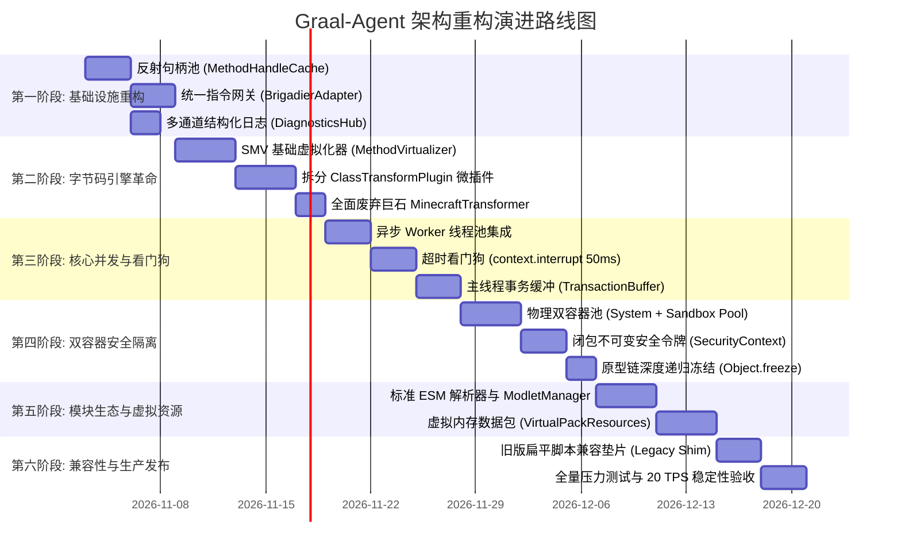

# 演进路线：平滑重构与迁移落地实施计划 (Refactoring and Migration Plan)

本实施计划旨在为项目团队提供从当前 `src/` 遗留单体代码平滑升级至 `docs/new_base/` 终极生产级架构的清晰操作路径。规划遵循**渐进式演进（Incremental Evolution）**与**零停机验证**原则，共划分为六个严密的工程阶段。

---

## 阶段演进总览甘特图

---

## 各阶段实施规范与验收标准

### 第一阶段：基础设施重构 (Foundation Infrastructure)
1. **构建 `MethodHandleCache`**：
   - 将现有散落于 `EnvironmentContext`、`AgentBridge` 与 `ServerCommandDispatcher` 的反射代码集中迁移；
   - 编写单元测试，验证所有方法句柄在类加载初期预热完成。
2. **抽取 `BrigadierAdapter`**：
   - 统一服务端与客户端的指令树构建，删除重复代理代码；
   - 验证：执行 `/js` 与 Tab 补全行为与重构前 100% 一致。
3. **升级 `DiagnosticsHub`**：
   - 引入异步日志缓冲与 ANSI 彩色渲染。

### 第二阶段：字节码引擎革命 (SMV Mesh Revolution)
1. **实现 `MethodVirtualizer`**：
   - 基于 JDK 22+ Class-File API 实现生成私有影子方法（`$$shadow$<method>`）与虚拟分发桩的通用逻辑。
2. **拆分 7 个独立插件**：
   - `ClientTickPlugin`, `KeyboardHandlerPlugin`, `PacketListenerPlugin` 等；
   - 废除原有的 400 行 `MinecraftTransformer`，将其降级为仅负责调度插件链的轻量级 `SMVOrchestrator`。
3. **验收标准**：
   - 游戏按键阻断、聊天拦截、服务端生命周期捕获测试全部绿灯通过。

### 第三阶段：核心并发与看门狗 (Concurrency & Anti-Hang)
1. **剥离 `ScriptManager` 的全局锁**：
   - 将 `onTick()` 与 `reload()` 替换为读写锁（`ReentrantReadWriteLock`）。
2. **落地 `AsyncWorkerPool` 与 `WatchdogTimer`**：
   - 将玩家执行链路切入独立工作线程；
   - **验收死循环**：在聊天框输入 `/js while(true) {}`，验证系统必须在 **50ms 内精准熔断**，主线程 TPS 保持 20.0 不卡顿！
3. **集成 `TransactionBuffer`**：
   - 异步脚本对世界实体的修改通过 MPSC 队列批量安全提交回主线程。

### 第四阶段：双容器零信任安全隔离 (Dual-Context Zero-Trust)
1. **建立双容器物理分离**：
   - 拆解为特权单例 `SystemContext` 与池化受控 `SandboxContextPool`；
   - 沙箱彻底剥离 `Java.type` 与全部宿主反射权限。
2. **实现 `SecurityContext` 闭包快照传递**：
   - 彻底修复前代通过 `setTimeout` 异步逃逸沙箱的高危漏洞；
   - **验收逃逸测试**：在沙箱内尝试通过定时器写文件，验证无论何时触发均必然抛出 `SecurityException`。

### 第五阶段：现代模块生态与虚拟内存资源 (Ecosystem & Virtual Pack)
1. **落地 ESM 运行时与 Modlet 规范**：
   - 支持 `scripts/modlets/<id>/manifest.json` 与 `import / export`；
   - 实现生命周期 `onEnable` 与 `onDisable`。
2. **研发 `VirtualPackResources`**：
   - 纯内存保存配方与战利品表 JSON，直接挂入 `PackRepository`；
   - 达成动态热重载零磁盘 I/O。

### 第六阶段：兼容性垫片与生产交付 (Compatibility & Delivery)
1. **旧版脚本兼容垫片 (Legacy Flat Script Shim)**：
   - 提供自动兼容层：若检测到 `scripts/` 根目录下存在旧版的扁平 `*.js`，自动将其虚拟包装为一个名为 `legacy_scripts` 的 Modlet 加载，确保老玩家既有脚本资产无缝运行。
2. **全系统基准测试**：
   - 内存占用评估、GC 停顿监测、并发压力测试。

---

## 风险应对与回滚方案 (Risk Mitigation)

| 潜在风险 | 影响程度 | 防范与回滚策略 |
| :--- | :--- | :--- |
| **JDK 22 Class-File API 跨小版本字节码格式变动** | 高 | 针对 `MethodVirtualizer` 建立全面的 Mock 字节码离线单测，在 CI 中自动跑多版本 JVM |
| **异步事务切回主线程的微小延迟** | 低 | 只读操作直接使用快照本地求值；写操作在 1 个 Tick 内提交，对于游戏交互人眼完全不可感知（<50ms） |
| **GraalVM Context 池化销毁时的内存占用** | 中 | 设定沙箱池容量上限（默认 4 个复用，脏化后异步回收），配合弱引用与显式 System GC 提示 |

---

## 相关文档双链

- [[Index]] - 返回技术蓝图索引
- [[Vision-and-Principles]] - 查看架构愿景与设计哲学
- [[System-Architecture]] - 查看系统分层拓扑
- [[Module-SMV-Mesh]] - 深入影子方法虚拟化网格
- [[Module-DualContext-Engine]] - 深入双容器与看门狗抢占机制
- [[Module-Security-Specification]] - 深入闭包安全令牌规范
