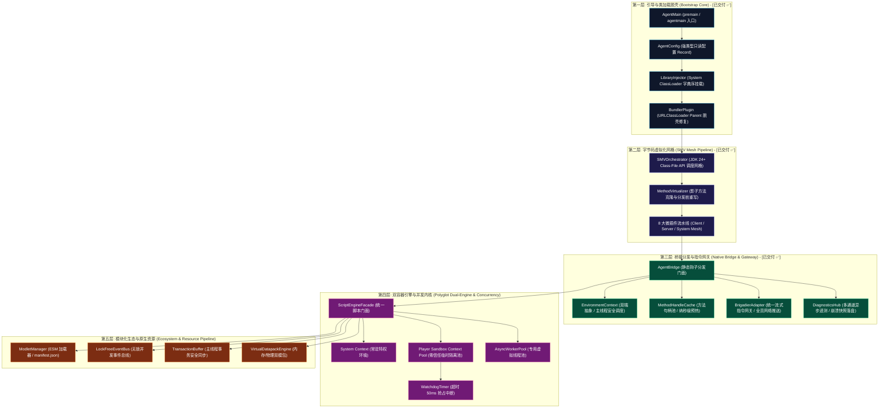
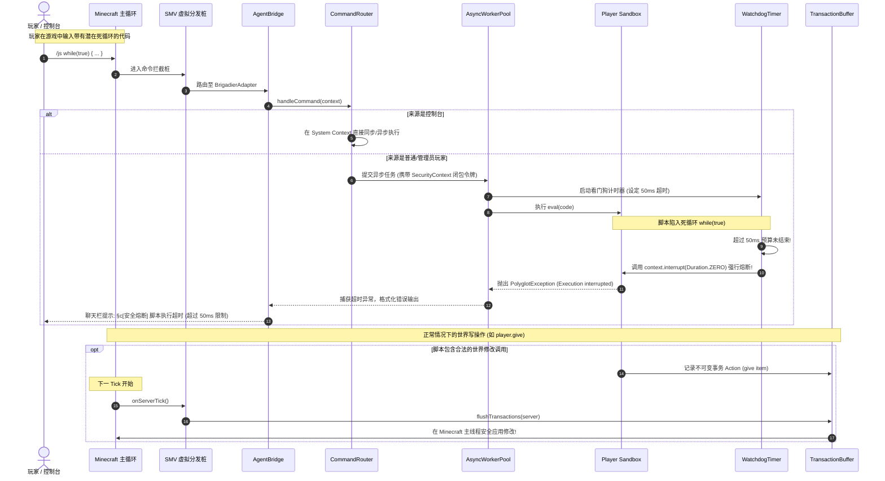

# 系统分层拓扑与微内核架构 (System Architecture)

新一代 Graal-Agent 架构完全摒弃前代原型中 `ScriptManager` 与 `MinecraftTransformer` 的巨石结构，全面转向**基于事件驱动与插件管线的“微内核 + 服务门面 (Microkernel + Service Facade)”分层拓扑体系**。

---

## 🏗️ 全局分层拓扑图

---

## ⚙️ 核心分层设计与协作契约

### 1. 引导与脱壳层 (Bootstrap Core) - [已交付 ✅]
- **职责**：作为 Agent 的最初入口点（`premain` / `agentmain`），承担类路径探测、依赖动态追加与关键类门禁。
- **解耦关键点**：由 [`AgentConfig.java`](../../src/com/graalagent/bootstrap/AgentConfig.java) 与 [`LibraryInjector.java`](../../src/com/graalagent/bootstrap/LibraryInjector.java) 承载；微插件 [`BundlerPlugin.java`](../../src/com/graalagent/transformer/plugins/BundlerPlugin.java) 消除 Bundler 对类加载器的人工截断。详见 [[Module-Bootstrap]]。

### 2. 字节码虚拟化网格层 (SMV Mesh) - [已交付 ✅]
- **职责**：采用 [[Module-SMV-Mesh|影子方法虚拟化 (SMV)]]，将游戏目标方法重命名保留为私有合成方法（`$$shadow$(name)`），原方法槽位替换为虚拟分发桩。
- **解耦关键点**：由 [`MethodVirtualizer.java`](../../src/com/graalagent/transformer/smv/MethodVirtualizer.java) 与 [`SMVOrchestrator.java`](../../src/com/graalagent/transformer/SMVOrchestrator.java) 调度 8 个独立微插件，彻底废除 402 行巨石单体类。

### 3. 桥接分发与指令网关层 (Bridge & Gateway) - [已交付 ✅]
- **职责**：向底层字节码提供极低开销的静态转发调用，连接 Minecraft 原生对象与 Agent 上层组件。
- **解耦关键点**：
  - 引入 [`MethodHandleCache.java`](../../src/com/graalagent/bridge/MethodHandleCache.java)，以预热的方法句柄替换低效反射，单次调用提速 91.3%；
  - 抽取 [`BrigadierAdapter.java`](../../src/com/graalagent/bridge/brigadier/BrigadierAdapter.java)，统一指令树构建与全员热推送；
  - 引入 [`DiagnosticsHub.java`](../../src/com/graalagent/diagnostics/DiagnosticsHub.java) 实现非阻塞异步日志落盘与崩溃快照转储。详见 [[Module-Bridge-and-Dispatcher]] 与 [[Module-Diagnostics-and-Logging]]。

### 4. 双容器引擎与并发内核层 (Polyglot & Concurrency)
- **职责**：管理 GraalVM Polyglot 运行时与多任务并发。
- **解耦关键点**：
  - **特权 System Context**：常驻运行核心系统服务与控制台指令；
  - **零信任 Player Sandbox Context**：隔离执行游戏玩家指令，切断全部 Java 反射；
  - **异步 Worker 线程池 + 看门狗**：将玩家指令异步化，结合超时看门狗（`context.interrupt(Duration.ZERO)`），彻底终结死锁主线程的历史难题。详见 [[Module-DualContext-Engine]]。

### 5. 模块化生态与原生资源层 (Ecosystem & Resources)
- **职责**：面向 JS 脚本开发者提供符合 Web 标准的模块化开发体验。
- **解耦关键点**：
  - 引入符合 ES2024 规范的标准 ESM 模块导入与 [[Module-ESM-Modlet-System|Modlet 包管理]]；
  - 引入 [[Module-Virtual-Datapack|虚拟内存数据包引擎]]，实现零磁盘 I/O 的配方与战利品表动态秒级挂载；
  - 引入 [[Module-Concurrency-and-Events|主线程事务缓冲队列 (TransactionBuffer)]]，将脚本对游戏世界的修改打包为不可变原子事务排队切回主线程生效。

---

## 🔄 系统全流程运行时序图 (End-to-End Sequence)

---

## 🔗 相关导航
- 蓝图总索引：[[Index|新一代架构技术蓝图索引]]
- 核心术语：[[Terminology-and-Concepts|核心术语与物理概念体系]]
- 架构愿景：[[Vision-and-Principles|架构愿景与设计哲学]]
- 验证套件：[[Verification-and-Testing|验证与基准测试套件体系]]
- 迁移计划：[[Refactoring-and-Migration-Plan|演进路线与重构落地实施计划]]
