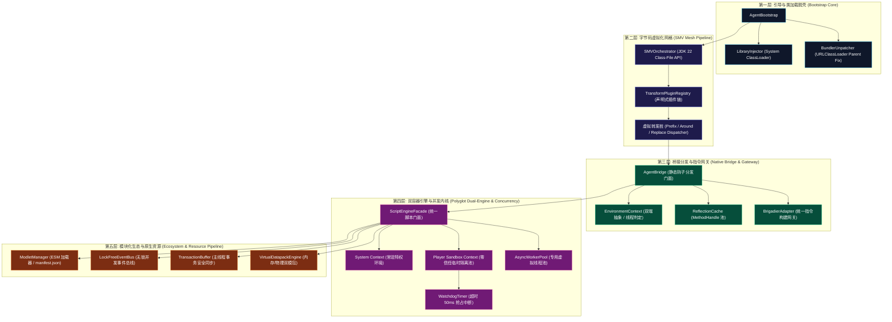
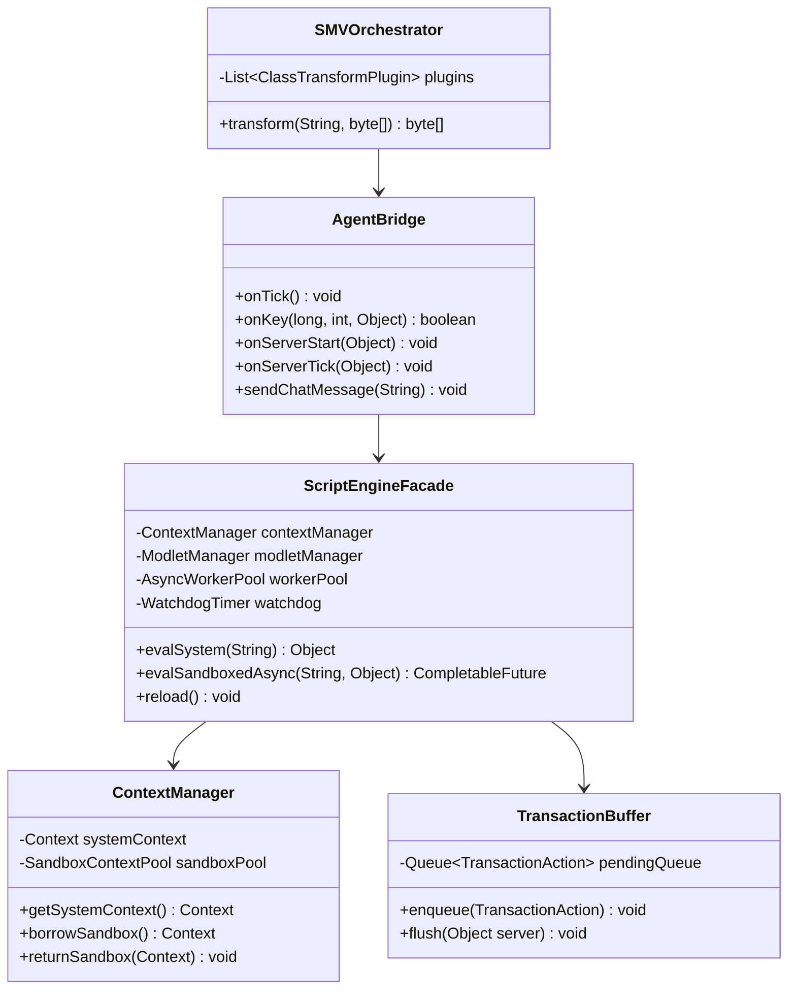

# 系统分层拓扑与微内核架构 (System Architecture)

新一代 Graal-Agent 架构完全摒弃前代原型中 `ScriptManager` 与 `MinecraftTransformer` 的巨石结构，全面转向**基于事件驱动与插件管线的“微内核 + 服务门面 (Microkernel + Service Facade)”分层拓扑体系**。

---

## 全局分层拓扑图



---

## 核心分层设计与协作契约

### 1. 引导与脱壳层 (Bootstrap Core)
- **职责**：作为 Agent 的最初入口点（`premain` / `agentmain`），承担类路径探测、依赖动态追加。
- **解耦关键点**：剥离原版 Bundler 的类加载器拦截逻辑为独立的 [`BundlerUnpatcher`](file:///H:/mc-mod/graal-agent/docs/new_base/Module-Bootstrap.md)，确保 Minecraft 内部类对系统类加载器完全透明。

### 2. 字节码虚拟化网格层 (SMV Mesh)
- **职责**：采用 [[Module-SMV-Mesh|影子方法虚拟化 (SMV)]]，将游戏目标方法重命名保留为私有影子方法（`$$shadow$<name>`），原方法槽位替换为虚拟分发桩。
- **解耦关键点**：由 `SMVOrchestrator` 根据 `TransformPluginRegistry` 中的微插件（`ClientHookPlugin`, `ServerLifecyclePlugin`, `CommandsPlugin` 等）声明式装配，彻底消除 400 行巨石类。

### 3. 桥接分发与指令网关层 (Bridge & Gateway)
- **职责**：向底层字节码提供极低开销的静态转发调用，连接 Minecraft 原生对象与 Agent 上层组件。
- **解耦关键点**：
  - 引入 [[Module-Bridge-and-Dispatcher#MethodHandleCache|ReflectionCache]]，使用预热的 `MethodHandle` 替换低效反射；
  - 抽取 [[Module-Bridge-and-Dispatcher#BrigadierAdapter|BrigadierAdapter]]，统一客户端与服务端的指令树构建与全员热推送。

### 4. 双容器引擎与并发内核层 (Polyglot & Concurrency)
- **职责**：管理 GraalVM Polyglot 运行时与多任务并发。
- **解耦关键点**：
  - **特权 System Context**：常驻运行核心系统脚本与控制台指令；
  - **零信任 Player Sandbox Context**：隔离执行游戏玩家 `/js`，切断全部 Java 反射；
  - **异步 Worker 线程池 + 看门狗**：将玩家指令异步化，结合超时看门狗（`context.interrupt`），彻底终结 `while(true)` 死锁主线程的历史难题。详见 [[Module-DualContext-Engine]]。

### 5. 模块化生态与原生资源层 (Ecosystem & Resources)
- **职责**：面向 JS 脚本开发者提供符合 Web 标准的开发体验。
- **解耦关键点**：
  - 引入符合 ES2024 规范的标准 ESM 模块导入与 [[Module-ESM-Modlet-System|Modlet 包管理]]；
  - 引入 [[Module-Virtual-Datapack|虚拟内存数据包引擎]]，实现零磁盘 I/O 的配方与战利品表动态秒级挂载；
  - 引入 [[Module-Concurrency-and-Events#TransactionBuffer|TransactionBuffer]]，将脚本对游戏世界的修改打包为原子事务排队切回主线程生效。

---

## 系统全流程运行时序图 (End-to-End Sequence)

```mermaid
sequenceDiagram
    autonumber
    actor Player as 玩家 / 控制台
    participant MC as Minecraft 主循环
    participant Hook as SMV 虚拟转发桩
    participant Bridge as AgentBridge
    participant Router as CommandRouter
    participant Worker as AsyncWorkerPool
    participant Sandbox as Player Sandbox
    participant WD as WatchdogTimer
    participant Buffer as TransactionBuffer

    Note over Player,MC: 玩家在游戏中输入带有潜在死循环的代码
    Player->>MC: /js while(true) { player.give("diamond"); }
    MC->>Hook: 进入命令拦截桩
    Hook->>Bridge: 路由至 BrigadierAdapter
    Bridge->>Router: handleCommand(context)

    alt 来源是控制台
        Router->>Router: 在 System Context 直接同步/异步执行
    else 来源是普通/管理员玩家
        Router->>Worker: 提交异步任务 (携带 SecurityContext 闭包令牌)
        Worker->>WD: 启动看门狗计时器 (设定 50ms 超时)
        Worker->>Sandbox: 执行 eval(code)
        
        Note over Sandbox,WD: 脚本陷入死循环 while(true)
        WD->>WD: 超过 50ms 阈值未结束!
        WD->>Sandbox: 调用 context.interrupt(Duration.ZERO) 强行熔断!
        Sandbox-->>Worker: 抛出 PolyglotException (Execution interrupted)
        Worker-->>Bridge: 捕获超时异常，格式化错误输出
        Bridge-->>Player: 聊天栏提示: §c[安全熔断] 脚本执行超时 (超过 50ms 限制)
    end

    Note over MC,Buffer: 正常情况下的世界写操作 (如 player.give)
    opt 脚本包含合法的世界修改调用
        Sandbox->>Buffer: 记录原子事务 Action (give diamond x1)
        Note over MC: 下一 Tick 开始
        MC->>Hook: onServerTick()
        Hook->>Buffer: flushTransactions(server)
        Buffer->>MC: 在 Minecraft 主线程安全应用修改!
    end
```

---

## 领域核心服务类图 (Domain Class Diagram)



---

## 相关文档双链

- [[Index]] - 返回技术蓝图索引
- [[Vision-and-Principles]] - 查看架构愿景与设计哲学
- [[Module-SMV-Mesh]] - 深入影子方法虚拟化网格
- [[Module-DualContext-Engine]] - 深入双容器与看门狗抢占机制
- [[Module-Bridge-and-Dispatcher]] - 深入桥接分发与指令网关
