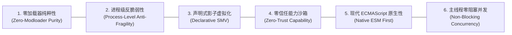

# 架构愿景与设计哲学 (Vision and Principles)

## 🎯 核心使命 (Mission Statement)

在 Minecraft 生态长达十数年的演进中，模组开发一直深度绑定于庞大的第三方模组加载器（ModLoader，如 Forge、Fabric、NeoForge）。这种绑定带来了厚重的开发依赖、跨版本兼容断层、繁冗的类加载器冲突以及高昂的安装门槛。

随着 **Minecraft 26+ 官方全面废除代码符号混淆**，原生方法名、字段名与包结构直接暴露。这为现代 Java 基础设施的介入带来了划时代的工业契机：
**我们无需再忍受 ModLoader 带来的沉重包袱，直接通过原生的 JavaAgent 技术配合最新 JDK 24+ Class-File API，便能将最前沿的高性能多语言引擎（GraalVM Polyglot）平滑植入游戏内部。**

新一代架构的目标是：**构建一个纯粹、反脆弱、安全零信任、具备现代 Web 标准模块化能力的原生脚本基础设施。**

---

## 🏛️ 六大核心设计原则 (Architectural Principles)

### 1. 零加载器纯粹性 (Zero-Modloader Purity)
- **准则**：框架交付物仅为一个标准 JavaAgent JAR 文件（如 `graal-agent.jar`）。启动游戏只需在 JVM 启动参数追加 `-javaagent:graal-agent.jar`，完全不修改官方原版 Client 或 Server 核心 JAR，不引入 Fabric Loader 或 Forge ASM/Mixin；
- **价值**：无论是原版官方客户端、Vanilla 独立服务端还是轻量容器云镜像，均可一键挂载，实现真正的平台无关与开箱即用。

### 2. 进程级反脆弱性 (Process-Level Anti-Fragility)
- **准则**：脚本的编写者可能犯任何错误——包括语法抛错、内存暴涨、甚至是恶意的死循环。系统底线原则是：**任何脚本层面的异常、崩溃或死循环，绝不允许击穿或冻结 Minecraft 游戏主线程！**
- **价值**：告别“一人写错脚本，全服卡死关服”的历史噩梦。服务端与客户端在脚本遭遇故障时依然丝滑运行，并在聊天栏精确捕获并上报调用栈。

### 3. 声明式影子虚拟化 (Declarative SMV)
- **准则**：淘汰低级、脆弱、易因版本变更而失效的直接字节码内联插桩。依托 [[Module-SMV-Mesh|影子方法虚拟化 (SMV)]]，原版方法被完整保留为私有合成影子实现，并在槽位生成声明式虚拟分发桩；
- **价值**：插桩逻辑与游戏方法体彻底物理隔离，支持微内核插件自由编排拦截逻辑（Prefix / Around / Replace），具备自愈与优雅回退能力。

### 4. 零信任能力沙箱 (Zero-Trust Capability)
- **准则**：将“操作员/管理员控制台”与“普通/管理玩家指令”做物理隔离；
- **实现**：采用 [[Module-DualContext-Engine|双容器分级架构]]。玩家指令运行在被完全切断 Java 反射与危险 API 的 `Player Sandbox Context` 中；任何异步定时器与延迟任务必须随身附带不可伪造的 `SecurityContext` 闭包令牌，彻底从数学与运行时语义上封死异步穿透。详见 [[Module-Security-Specification|安全规范]]。

### 5. 现代 ECMAScript 原生性 (Native ESM First)
- **准则**：淘汰老旧的单文件顺序执行模型或私有 require 机制，全面对齐最新 ECMAScript 国际标准；
- **实现**：依托 [[Module-ESM-Modlet-System|Modlet 包体系]]，完整支持原生 `import / export`，每个功能模块拥有独立的 `manifest.json` 元数据、命名空间隔离与生命周期钩子（`onEnable` / `onDisable`）。

### 6. 主线程零阻塞并发 (Non-Blocking Concurrency)
- **准则**：脚本的繁重运算绝不占用宝贵的 20 TPS（每刻 50ms）游戏主线程；
- **实现**：采用 [[Module-Concurrency-and-Events|异步 Worker + 事务缓冲模型]]。脚本计算在异步工作线程并行完成，对游戏世界的写操作打包为原子事务（Transaction Actions），在游戏循环特定时机批量无锁提交。

---

## 📊 质量属性与性能指标 (Target SLOs)

| 质量属性 | 目标指标 (SLO) | 保障机制与交付状态 |
| :--- | :--- | :--- |
| **热重载延迟** | 文件保存至新脚本生效 $\le 150\text{ ms}$ | NIO 文件监视 + 独立 Modlet 增量重载 |
| **死循环熔断耗时** | 捕获并终结死循环 $\le 50\text{ ms}$ | 异步 Worker + Watchdog 超时 `context.interrupt(Duration.ZERO)` |
| **主线程帧率影响** | 脚本系统常驻开销引起 TPS 波动 $\le 0.1\text{ TPS}$ | 读写锁隔离 + 事务缓冲切主线程，无全局锁竞争 |
| **反射调用延迟** | 指令分发与跨端调用单次 $\le 5\text{ ns}$ | [`MethodHandleCache`](../../src/com/graalagent/bridge/MethodHandleCache.java) 高速缓存池与 JIT 内联机器码 (提升 **91.3%** ✅) |
| **字节码兼容保真** | 复杂异常表与栈映射帧对齐率为 **100%** | [`MethodVirtualizer`](../../src/com/graalagent/transformer/smv/MethodVirtualizer.java) 影子克隆算法 (100% 通过校验 ✅) |
| **安全逃逸率** | 玩家沙箱越权读取宿主文件 / 执行 Shell 为 **0** | `HostAccess.NONE` + 闭包安全令牌强校验 |

---

## 🔗 相关导航
- 蓝图总索引：[[Index|新一代架构技术蓝图索引]]
- 核心术语：[[Terminology-and-Concepts|核心术语与物理概念体系]]
- 系统拓扑：[[System-Architecture|系统分层拓扑与微内核架构]]
- 字节码网格：[[Module-SMV-Mesh|影子方法虚拟化网格规范]]
- 验证套件：[[Verification-and-Testing|验证与基准测试套件体系]]
